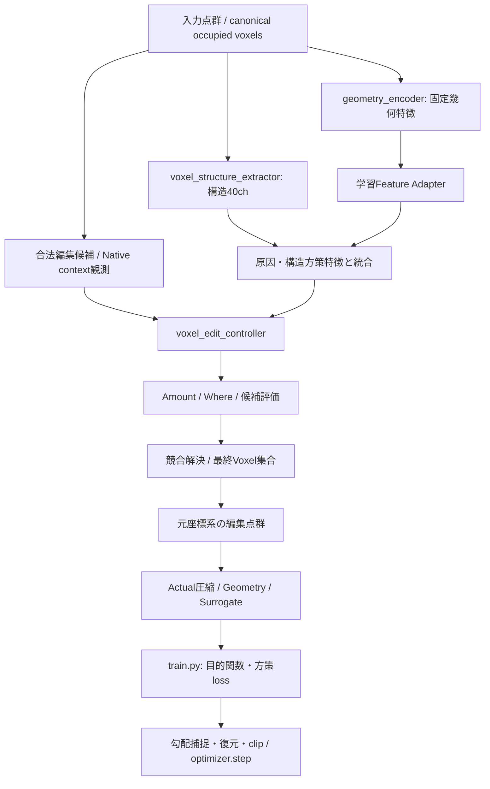

# 訓練コードを読むための案内

2026-11-13の名称整理に対応する。計算方法・設定値・checkpointの保存キーは変更していない。
まず `train.py` の目的関数と更新処理、次に `models/network.py` の接続を読むと、
「何を選択して、何を教師に更新しているか」を追いやすい。

## 主要な入口

| 知りたいこと | ファイル・入口 | 役割 |
|---|---|---|
| 引数と既定値 | `models/utils/config/args.py` | `test_route`、損失係数、Codec、データ指定。今回変更していない |
| 訓練の順序 | `train.py`: `train` | データ取得、forward、損失合成、勾配処理、更新、記録 |
| Networkの接続 | `models/network.py`: `Network.__init__`, `Network.forward` | モジュール配置とTensorの受け渡し |
| 幾何特徴 | `models/encoder/point_trans.py`: `PointTransformer` | 固定Encoder側。Feature Adapterの学習とは区別する |
| Voxel構造特徴 | `models/modules/voxel_structure_features.py`: `VoxelStructureFeatureExtractor` | 40chの構造観測。Codec実NLLそのものではない |
| 合法な編集候補と固定観測 | `models/utils/pointcloud/voxel_candidate_guidance.py`: `attach_voxel_candidate_guidance`, `build_legal_candidate_reservoir` | True経路の候補受け渡しと、従来経路との分岐 |
| 従来参照plan | `models/utils/pointcloud/reference_voxel_plan.py`: `attach_reference_voxel_plan` | 研究時の参照planを使う経路。True経路と混同しない |
| 候補の座標・特徴の対応付け | `models/modules/heuristic_guidance.py`: `build_heuristic_guidance` | 候補と点・方向indexの対応、固定特徴 |
| 操作の決定と適用 | `models/modules/voxel_edit_controller.py`: `VoxelEditController.forward`, `build_joint_voxel_edit_plan` | Amount / Where、候補競合、最終Voxel集合 |
| 表示・連続勾配側の目的 | `models/utils/training/compression_primary_loss.py`: `build_compression_primary_loss` | 圧縮主目的、Geometry、補助項の合成 |
| Actual共同方策の目的 | `models/utils/training/joint_voxel_policy.py`: `compute_joint_voxel_policy_loss` | 実測costに基づく方策loss、集合価値回帰、Entropy等 |
| 勾配の捕捉・復元 | `models/utils/training/train_runtime.py`: `capture_joint_policy_gradients`, `restore_joint_policy_gradients` | backward後の勾配をどう更新に使うか |
| 役割別clip | `models/utils/training/joint_voxel_policy.py`: `clip_joint_gradients` | Where、Amount、Actor、Critic等を分けたclip |
| 圧縮評価 | `models/utils/loss/compression.py`, `surrogate.py`, `actual_encoder.py` | 実圧縮・Surrogateと訓練側の接続。今回Codec計算は変更していない |

## Networkの見取り図

`test_route=True` の主経路の読み順を示す。固定観測の生成にも分岐・キャッシュがある。
詳細な条件は各関数を参照する。

## モジュール名と保存名を区別する

`Network`では以下の読み取り用propertyを使う。同一Moduleを参照し、二重登録しない。

| 読む際の名前 | checkpointの登録名 |
|---|---|
| `geometry_encoder` | `encoder` |
| `voxel_structure_extractor` | `structure_analyzer` |
| `voxel_edit_controller` | `actuator` |

`VoxelEditController`も同様に、`prune_location_head` / `prune_amount_head`、
`adjust_source_head` / `adjust_direction_head` / `adjust_amount_head`、
`candidate_actor` / `candidate_proposal` / `candidate_critic` / `plan_value_estimator`
という読み取り用propertyを持つ。
元の`drop_head`、`den6_candidate_actor`等の登録名は、既存checkpointの復元と
Optimizerのパラメータ順序を保つため残している。名前のために新しいNNを生成していない。

## 目的関数と係数の読み方

- `L_total`: `train.py`で合成する全体目的。単一の固定式ではなく、モードにより合成後の更新がある。
- `L_com`: 圧縮側のloss Tensor。Actual百分率やSurrogate単体値と同一だと決めつけない。
- `L_geom`: Geometry loss Tensor。
- `L_compression_weighted`: 圧縮優先目的の主項。
- `L_geometry_weighted_forward`: Geometryのforward重みを反映した項。
- `L_geometry_backward_scaled`: forward値を保ち、既存のbackward倍率を反映した項。
- `L_auxiliary` / `L_auxiliary_balanced`: 補助項の合計 / 既存balance適用後。
- `L_joint_policy`: Actual共同方策の更新に使う合計。
- `L_compression_policy` / `L_geometry_policy`: 圧縮 / 幾何costのscore-function項。
- `L_plan_value` / `L_policy_entropy` / `L_edit_efficiency` / `L_measured_plan_replay`: 集合価値回帰 / Entropy / 編集効率 / 実測plan自己模倣。

`L_...`は損失、`..._weight`や`w_...`は係数として区別する。
既存のCLI係数名`w_com`、`cp_lambda_geom`等は変更していない。
画面の`StepLoss`、図の値、backwardで使う勾配は同一とは限らない。
`train.py`の「目的関数: L_total」から、gradient-only項・勾配置換・clipまで読む。

## 旧名を見つけた場合

| 以前の実装ファイル | 現在の実装ファイル |
|---|---|
| `models/modules/octree_structure.py` | `models/modules/voxel_structure_features.py` |
| `models/modules/structure_actuator.py` | `models/modules/voxel_edit_controller.py` |
| `models/utils/pointcloud/ana_den6_online.py` | `models/utils/pointcloud/voxel_candidate_guidance.py` |
| `models/utils/pointcloud/ana_den6_reference.py` | `models/utils/pointcloud/reference_voxel_plan.py` |
| `models/utils/training/autonomous_joint_learning.py` | `models/utils/training/joint_voxel_policy.py` |

旧ファイルは互換用の短い入口で、実装を二重に持たない。
旧importと新importは同一のmodule object・同一cacheを共有する。
旧クラス・関数名も呼び出し互換のaliasを残す。
ただし診断用に関数を差し替える場合は、実際の呼び出し先となる新名を対象にする。

`ana_den6_online`という引数値、CSV列名、debug辞書、cache schema、checkpointキーは
過去成果物との互換契約として残す。文字列の一括置換は行っていない。
過去の報告書の行番号は当時のsnapshotのものなので、現在の入口は本表で辿る。

## 今回削除したもの

`models/encoder/point_trans.py`の未使用import `math`と`gumbel_softmax`のみ。
ファイル内で名前参照がないことを確認した。関数・モード・計算は削除していない。
通常経路で未使用でも、他Codec、False経路、テスト、独立実験から使われる処理があるため、
「最新のTrue経路で見えない」という理由だけでは削除しない。

検証結果は [名称整理の実測報告](reports/20261113_readability_refactor.md) を参照。
