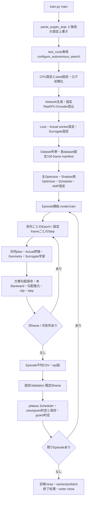
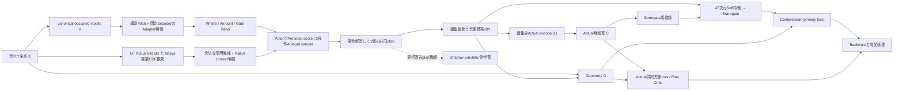
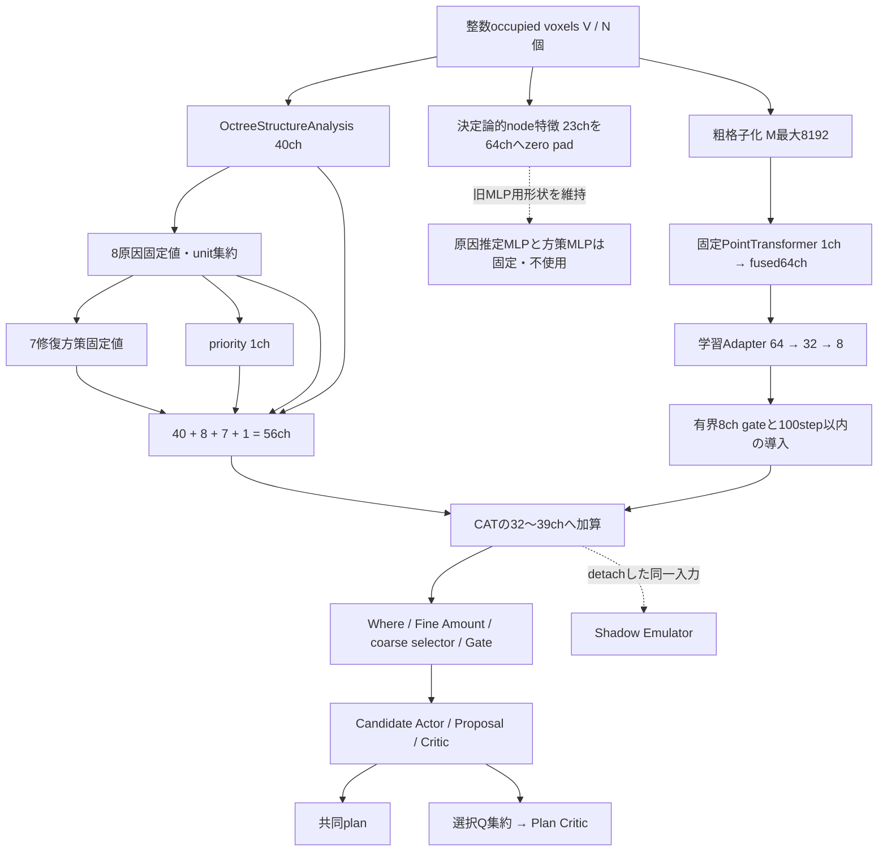
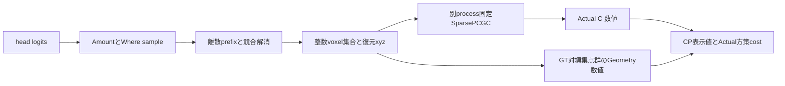
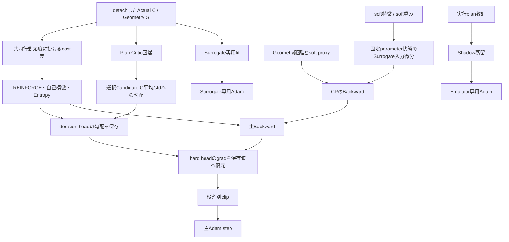

# `train.py --test_route True`：修士論文向け訓練システム技術解析

調査日：2026-11-09（JST）。本書は**現在のソースを静的に追跡した設計解析**である。訓練・推論・評価・引数パーサの実行、checkpointの読み書きは行っていない。数値を示す場合、設定値・数式から決まる値・実行時に依存する値を区別する。勾配の実測値や圧縮改善率を今回測定したとは主張しない。

## 1. 解析対象と調査範囲

### 1.1 解析した版と変更防止

- 最終確認した解析基準HEAD：`c1e9856a7308f2139e3befb4476cd20891040b8e`（2026-11-09のcommit）。
- 調査冒頭には前HEAD `1fd43f04d0d94de31d5ad36245824f0cb66e6c8e` と、args・Actual wrapper・host memory関連の既存変更を確認した。その後HEADが `c1e9856` へ進み、これらがcommitに含まれた状態を最終確認した。**本調査ではGitのcommit・checkout・reset等を行っていない。** SHA256を記録した対象193 Pythonファイルは最終確認まで一致した。保存済み `git_status_start.txt` と `working_tree_start.diff` は空であり、hash採取時の追跡ファイル状態はcleanである。
- Native SparsePCGCは別ディレクトリの実装なので、このHEADだけで外部Codec・checkpointの全状態まで固定されるわけではない。 source hash記録を併せて用いる。
- 既存コード・設定・checkpoint・ログ・既存資料は変更していない。本書だけを新規作成した。調査用のGit差分、定義索引、対象193 PythonファイルのSHA256は `/data/maejima/log/independent_experiments/20261109_thesis_system_readonly_ucc7nukt/` に別途保存した。
- 実行対象を「現在の設定ファイルのまま、追加指定は `--test_route True` のみ」と定義する。GPUの可用性、環境変数、実在する入力ファイル、外部checkpointの中身に依存する結果までは静的解析では確定しない。

### 1.2 最初に押さえる実装上の事実

1. 対象CodecはSparsePCGC、主経路名は `ana_den6_online` だが、True時にはその内部で**独立Amount・合法候補pool・共同Actual方策学習**へ分岐する。関数名のden6を、そのまま過去に発見したden6行動の強制採用と読んではいけない。
2. 原因推定MLPと修復方策MLPは存在するが、現在は `direct_octree_structure_targets=True` により固定構造値で代替される。すべての箱が学習する構成ではない。
3. Candidate Criticの出力は、候補ごとにActual encodeした真の限界gainではない。選択集合を要約したPlan Criticの回帰を通じて間接学習する潜在値である。
4. 最終行動は離散集合編集。Actual Codecは非微分であり、hard decision headは主にActualのscore-function勾配で更新される。Surrogateの勾配がそのまま全headの最終更新へ加算されるわけではない。
5. 訓練のGeometryは**GTと編集後点群**の誤差であり、現設定ではCodec復号点群のD1/D2 PSNRではない。
6. `test.py` の既定推論はShadow Studentへ切り替える実装があり、訓練内のgreedy Validationと同一経路だと断定できない。

根拠：[models/utils/training/sparsepcgc_autonomous_policy.py — autonomous_search_enabled（L12）](/home/maejima/MasterEx/myNet/models/utils/training/sparsepcgc_autonomous_policy.py:12)、[models/utils/training/sparsepcgc_autonomous_policy.py — configure_autonomous_search（L29）](/home/maejima/MasterEx/myNet/models/utils/training/sparsepcgc_autonomous_policy.py:29)、[models/network.py — Network.__init__：direct構造ターゲット（L179）](/home/maejima/MasterEx/myNet/models/network.py:179)、[models/utils/training/autonomous_joint_learning.py — joint_actual_policy_loss（L112）](/home/maejima/MasterEx/myNet/models/utils/training/autonomous_joint_learning.py:112)、[models/utils/training/train_runtime.py — _capture_den6_policy_only_gradients（L5181）](/home/maejima/MasterEx/myNet/models/utils/training/train_runtime.py:5181)、[test.py — main：Studentへの切替（L803）](/home/maejima/MasterEx/myNet/test.py:803)。

### 1.3 記号

| 記号 | 意味・形状 |
|---|---|
| \(X\) | 元GT点群、\([1,3,N_0]\)。PLY由来の元座標 |
| \(V\) | canonicalな重複排除後の占有voxel集合、\([1,3,N]\)、整数 |
| \(Y\) | 最終共同planを反映し、元座標系へ復元した点群、\([1,3,N']\) |
| \(\hat Y\) | Codecによる復号点群。通常の本訓練Stepでは生成しない |
| \(B_0,B_1\) | 同一Codec条件でのGT・編集後の訓練用符号量 |
| \(C\) | Actual符号量増減率、\(100(B_1/B_0-1)\)、単位% |
| \(G\) | 訓練用Geometry損失。主に対称二乗ChamferとAdd Fit |
| \(o\) | 操作種別、Add / Prune / Adjust |
| \(\operatorname{sg}\) | `detach()`と同じstop-gradient |
| \(Z(t)\) | \(t-\operatorname{sg}(t)\)。Forwardは0、Backwardは\(t\) |

## 2. システム全体の概要

### 2.1 目的・入出力

元点群を微小な占有集合編集により変形し、固定されたSparsePCGCの符号量を削減しつつ、編集による幾何誤差を抑える。NetworkがCodecそのものを置き換える方式ではない。入力フレームごとに3操作を含む**1個の実行plan**を作り、その編集後全点群をActual encodeする。未実行の多数planを毎Step全部encodeして最良を選ぶ構成ではない。

根拠：[train.py — train：get_compression_loss呼出し（L1232）](/home/maejima/MasterEx/myNet/train.py:1232)、[models/modules/structure_actuator.py — StructureRepairActuator._build_exact_den6_residual_plan：1sample plan構築（L6895）](/home/maejima/MasterEx/myNet/models/modules/structure_actuator.py:6895)、[models/utils/loss/actual_encoder.py — _SparsePCGCActualEncoder.encode_bits（L1173）](/home/maejima/MasterEx/myNet/models/utils/loss/actual_encoder.py:1173)。

### 2.2 実行開始から終了まで



上図の詳細初期化順には `train()` に入ってから作るDataset・Optimizer等を含む。例外時にもmainの終了処理があり、例外を成功・収束として扱うわけではない。既定は382 Episodeで終了し、`train_until_converged=False` のため「実測収束を確認するまで無限継続」ではない。

根拠：[train.py — main（L6481）](/home/maejima/MasterEx/myNet/train.py:6481)、[train.py — train（L9）](/home/maejima/MasterEx/myNet/train.py:9)、[train.py — 固定Episode frame構成（L249）](/home/maejima/MasterEx/myNet/train.py:249)、[train.py — Emulator optimizer生成（L448）](/home/maejima/MasterEx/myNet/train.py:448)、[train.py — Episode loop（L515）](/home/maejima/MasterEx/myNet/train.py:515)、[train.py — Episode Validation（L5899）](/home/maejima/MasterEx/myNet/train.py:5899)、[train.py — 終了・収束判定（L6440）](/home/maejima/MasterEx/myNet/train.py:6440)。

### 2.3 1 Stepのデータフロー



Native確率観測はGTの符号化時に取得し、候補編集後の全contextをその場で再計算するものではない。Actualは最後の共同plan全体を再符号化して評価する。GT bitsは同じ入力・設定でcache可能だが、編集後Actualは現設定で毎Step更新する。

根拠：[models/utils/loss/autonomous_codec_context.py — prepare_codec_context（L25）](/home/maejima/MasterEx/myNet/models/utils/loss/autonomous_codec_context.py:25)、[models/utils/pointcloud/autonomous_proposals.py — build_autonomous_pool（L24）](/home/maejima/MasterEx/myNet/models/utils/pointcloud/autonomous_proposals.py:24)、[models/utils/loss/surrogate.py — _get_compression_loss_surrogate（L947）](/home/maejima/MasterEx/myNet/models/utils/loss/surrogate.py:947)。

## 3. ソースコードの依存関係

| ファイル・入口 | 担当する処理 | 対象経路での位置 |
|---|---|---|
| [train.py — main（L6481）](/home/maejima/MasterEx/myNet/train.py:6481) / [train.py — train（L9）](/home/maejima/MasterEx/myNet/train.py:9) | 初期化、frame loop、損失統合、更新、検証、保存 | 実行統括 |
| [models/utils/config/args.py — parse_pugan_args内 parse_args以降（L3826）](/home/maejima/MasterEx/myNet/models/utils/config/args.py:3826) / [cfgs/utils.py — str2boolを含む設定utility（L1）](/home/maejima/MasterEx/myNet/cfgs/utils.py:1) | CLI・mode別上書き | parserのdefaultだけで判断不可 |
| [models/utils/training/sparsepcgc_autonomous_policy.py — configure_autonomous_search（L29）](/home/maejima/MasterEx/myNet/models/utils/training/sparsepcgc_autonomous_policy.py:29) | True用Amount空間・prior無効化 | 最終設定 |
| [models/utils/data/dataset.py — PlyDirDataset（L198）](/home/maejima/MasterEx/myNet/models/utils/data/dataset.py:198) / [models/utils/training/episode_frames.py — configure_fixed_episode_frames（L12）](/home/maejima/MasterEx/myNet/models/utils/training/episode_frames.py:12) | PLY入力、訓練分割、固定100frame | 入力 |
| [models/network.py — Network（L46）](/home/maejima/MasterEx/myNet/models/network.py:46) | 構造・特徴・Actuatorの接続 | 提案Network |
| [models/encoder/point_trans.py — PointTransformer（L77）](/home/maejima/MasterEx/myNet/models/encoder/point_trans.py:77) | 固定済み幾何特徴抽出 | coarse特徴のみ |
| [models/modules/octree_structure.py — OctreeStructureAnalysis.forward（L1950）](/home/maejima/MasterEx/myNet/models/modules/octree_structure.py:1950) | 40ch構造記述・8原因proxy・葉pattern診断 | 非学習的観測 |
| [models/modules/cause_aggregation.py — CauseDiagnosisAggregation.forward（L58）](/home/maejima/MasterEx/myNet/models/modules/cause_aggregation.py:58) | repair unit平均、priority | refineは不使用 |
| [models/modules/structure_policy.py — StructureRepairPolicy.build_teacher（L39）](/home/maejima/MasterEx/myNet/models/modules/structure_policy.py:39) | 原因→7カテゴリ固定変換 | MLPの代替 |
| [models/modules/structure_actuator.py — StructureRepairActuator（L247）](/home/maejima/MasterEx/myNet/models/modules/structure_actuator.py:247) | Where/Amount/Gate、候補logit、集合編集 | 離散行動の中心 |
| [models/utils/pointcloud/ana_den6_online.py — autonomous分岐（L374）](/home/maejima/MasterEx/myNet/models/utils/pointcloud/ana_den6_online.py:374) | 既存入口からTrue専用builderへ接続 | 過去den6 cacheとは分岐 |
| [models/utils/pointcloud/autonomous_proposals.py — _build_autonomous_pool（L87）](/home/maejima/MasterEx/myNet/models/utils/pointcloud/autonomous_proposals.py:87) / [models/utils/pointcloud/autonomous_context_arrays.py — context_proposals_arrays（L76）](/home/maejima/MasterEx/myNet/models/utils/pointcloud/autonomous_context_arrays.py:76) | 合法候補生成・Native候補統合 | 固定ルール |
| [models/utils/training/autonomous_joint_learning.py — sample_joint_amounts（L16）](/home/maejima/MasterEx/myNet/models/utils/training/autonomous_joint_learning.py:16) / [models/utils/training/autonomous_joint_learning.py — joint_actual_policy_loss（L112）](/home/maejima/MasterEx/myNet/models/utils/training/autonomous_joint_learning.py:112) | sampling、尤度、REINFORCE、集合Critic | True専用学習 |
| [models/utils/training/autonomous_local_search.py — prepare_neighbourhood（L58）](/home/maejima/MasterEx/myNet/models/utils/training/autonomous_local_search.py:58) / [models/utils/training/autonomous_actual_replay.py — measured_plan_replay（L17）](/home/maejima/MasterEx/myNet/models/utils/training/autonomous_actual_replay.py:17) | 自己発見plan周辺探索・自己模倣 | 訓練時のみ |
| [models/utils/loss/compression.py — get_compression_loss分岐（L2537）](/home/maejima/MasterEx/myNet/models/utils/loss/compression.py:2537) / [models/utils/loss/surrogate.py — _get_compression_loss_surrogate（L947）](/home/maejima/MasterEx/myNet/models/utils/loss/surrogate.py:947) | ActualとSurrogate接続 | 圧縮loss |
| [models/utils/loss/actual_encoder.py — _SparsePCGCActualEncoder（L349）](/home/maejima/MasterEx/myNet/models/utils/loss/actual_encoder.py:349) / [models/utils/loss/sparsepcgc_teacher_worker.py — _build_encoder（L234）](/home/maejima/MasterEx/myNet/models/utils/loss/sparsepcgc_teacher_worker.py:234) | 別process常駐Codec、IPC、メモリadmission | Codec wrapper |
| [models/utils/loss/geometry.py — get_geometry_loss（L443）](/home/maejima/MasterEx/myNet/models/utils/loss/geometry.py:443) | CD・追加点Fit・STE補助 | Geometry |
| [models/utils/training/compression_primary_loss.py — build_compression_primary_loss（L257）](/home/maejima/MasterEx/myNet/models/utils/training/compression_primary_loss.py:257) | 主損失と動的補助balance | 表示・Backwardを区別 |
| [models/utils/training/optim_amp.py — build_optimizer_and_scheduler（L38）](/home/maejima/MasterEx/myNet/models/utils/training/optim_amp.py:38) | パラメータ群、LR、clip | 更新 |
| [models/modules/single_plan_student.py — SinglePlanStudentPolicy（L14）](/home/maejima/MasterEx/myNet/models/modules/single_plan_student.py:14) / [models/utils/loss/single_plan_distillation.py — SinglePlanDistillationLoss.forward（L342）](/home/maejima/MasterEx/myNet/models/utils/loss/single_plan_distillation.py:342) | Shadow plan生成・蒸留 | 別Optimizer |
| [models/utils/training/train_runtime.py — run_episode_full_cloud_validation（L6530）](/home/maejima/MasterEx/myNet/models/utils/training/train_runtime.py:6530) | 固定GTでgreedy評価 | 訓練内Validation |
| [test_BDrate.py — main（L110）](/home/maejima/MasterEx/myNet/test_BDrate.py:110) / [utils/bdrate/runner.py — run（L68）](/home/maejima/MasterEx/myNet/utils/bdrate/runner.py:68) | 実復号とPSNRによる別評価 | trainから自動実行しない |

`train_runtime.py` は多数の関数を再exportするため、`train.py` の呼び出し名だけで実体ファイルを決めないこと。特にoptimizer、frame構成、loss builder、デバッグ、checkpointは分割実装される。

## 4. Networkアーキテクチャ

### 4.1 現在の接続図



**重要：64ch幾何特徴を40ch構造特徴へ単純に全結合concatする構成ではない。** 現在のActuator入力は56chであり、固定Encoderからの8ch Adapter残差をそのうち32～39chへ加算する。64chのnode特徴にはdeterministicな補助表現も存在するが、固定された原因MLPを現在学習しているわけではない。

根拠：[models/network.py — Network.__init__（L126）](/home/maejima/MasterEx/myNet/models/network.py:126)、[models/network.py — _build_node_features_from_voxel_coords（L4282）](/home/maejima/MasterEx/myNet/models/network.py:4282)、[models/network.py — Network.forward：Actuator入力合成（L6226）](/home/maejima/MasterEx/myNet/models/network.py:6226)。

### 4.2 Tensorの主要な境界

| 境界 | 入力→出力 | 備考 |
|---|---|---|
| DataLoader→Network | `[1,N0,C]`→`[1,C,N0]` | xyzは先頭3ch。訓練用点群全体を保持 |
| canonical化 | `[1,3,N0]`→整数`[1,3,N]` | 重複occupied voxelを1個へ |
| node観測 | 整数座標→`[1,64,N]` | 23個の座標・parity・親mask等のchをzero pad |
| Encoder | `[1,3,M]`座標と`[1,1,M]`ones→local/fused特徴 | M≤8192。入力編集点数NをMへ減らさない |
| Adapter | `[1,64,M]`→`[1,8,M]`→`[1,8,N]` | full-to-coarse写像でgather |
| 構造解析 | xyz/整数metadata→`[1,40,N]` | 8原因ターゲット等を別dictにも出す |
| unit集約・方策 | `[1,8,N]`,`[1,7,N]`,`[1,1,N]` | priorityは1ch |
| Actuator入力 | `[1,56,N]` | 幾何残差を一部chへ加算 |
| Where | Prune/Add/source `[1,1,N]`、Add/Move方向 `[1,26,N]` | 候補のsource/directionへ索引 |
| coarse Amount | 各点Conv 56→64→16後の平均→16 logits | 共通headを各操作別の分布へ変換 |
| Fine Amount | 操作別Conv1d→平均→各1 scalar | 連続log倍率分布の平均 |
| Candidate | 操作別`[Mo,7]`→Actor/Proposal各`[Mo]`、Critic`[Mo,2]` | Moは入力依存 |
| Plan Critic | 選択集合要約`[1,18]`→`[1,2]` | 現在の共同lossは主に第1出力使用 |
| 最終編集 | 整数`[1,3,N']`→元座標系xyz | Actual用の集合を別に確定 |

根拠：[models/utils/training/train_flow.py — prepare_full_cloud_input_pcd（L57）](/home/maejima/MasterEx/myNet/models/utils/training/train_flow.py:57)、[models/utils/pointcloud/sparse_tensor.py — build_sparse_point_tensor_single（L127）](/home/maejima/MasterEx/myNet/models/utils/pointcloud/sparse_tensor.py:127)、[models/network.py — _point_transformer_features_for_nodes（L936）](/home/maejima/MasterEx/myNet/models/network.py:936)、[models/modules/structure_actuator.py — _den6_actor_critic_candidate_values（L4356）](/home/maejima/MasterEx/myNet/models/modules/structure_actuator.py:4356)。

## 5. 各モジュールの詳細設計

### 5.1 入力・canonical occupied voxel表現

**役割**：Network、候補、Actual、Geometryが異なる量子化基準を参照しないようにする。

入力は元座標系xyz。`quantize_sparsepcgc_coords` は `canonical_sparsepcgc_voxel_coords` を正式入口として呼び、step・offset等をmetadataとして保持する。復元は原則

\[
 x(v)=o+qv
\]

であり、通常 `center=False` のため余計な半voxel加算はしない。SparsePCGCのeffective stepは `voxel_size * pos_quantscale`。現在はいずれも1、`sparsepcgc_match_qs=False` のため、一般引数 `qs=2` を見て「Actualも2voxel量子化」としてはいけない。負座標のshift等も正式metadataへ従う。

全点入力を編集用にランダムサンプリングする処理はこのfull-cloud経路にはない。Encoderだけを粗格子化する点とは区別する。

根拠：[models/utils/pointcloud/sparsepcgc_voxel.py — quantize_sparsepcgc_coords（L5）](/home/maejima/MasterEx/myNet/models/utils/pointcloud/sparsepcgc_voxel.py:5)、[models/utils/pointcloud/sparsepcgc_voxel.py — dequantize_sparsepcgc_coords（L25）](/home/maejima/MasterEx/myNet/models/utils/pointcloud/sparsepcgc_voxel.py:25)、[models/utils/training/train_runtime.py — _build_full_cloud_octree_context_for_train（L3119）](/home/maejima/MasterEx/myNet/models/utils/training/train_runtime.py:3119)、[models/utils/config/args.py — effective_qs設定（L5302）](/home/maejima/MasterEx/myNet/models/utils/config/args.py:5302)。

### 5.2 固定PointTransformer：RepKPU由来の幾何Encoder

**役割**：粗い点集合から局所・大域の形状特徴を得る。元のRepKPU全モデルで点群upsamplingするわけではない。

**前処理**：`build_sparse_point_tensor_single` はTorchの座標・feature dictを作る。ここにSparseTensorという名称があっても、このEncoder自身がMinkowskiEngine sparse convolutionになるわけではない。予算を超えるとvoxel幅を増やして格子内中心を集約し、必要なら密度上位coarse cellを残して最近傍へ再対応する。全点からcoarse点への対応を残す。

**Layer構成**（現行C=64、k=8）：

1. feature=ones 1chへConv1d `1→64→64`、ReLU。任意BNは `encoder_bn=False`。
2. `attn11/12/13` の3 Blockを順に通し、その3出力concat `192→64` Conv1d + **無条件BN** + ReLUでfeat1。
3. 同じ構成の `attn21/22/23` →feat2、`attn31/32/33` →feat3。合計9 Vector Attention Block。
4. local特徴はfeat1/2/3のconcatで192ch。
5. global MLP `64→64→128`、点方向maxをbroadcastした128ch。
6. feat0/1/2/3各64chとglobal128chをconcatした384chを `384→128→64` Conv1d、BN、ReLUでfused64chへ。

**Vector Attention Block**：近傍集合 \(\mathcal N_k(i)\) に対し、Q/K/Vを別々の1×1 Convで作る。

\[
 q_i=W_qf_i,\quad k_j=W_kf_j,\quad v_j=W_vf_j,
\]
\[
 \delta_{ij}=\operatorname{GeoMLP}(x_i-x_j),\quad
 \alpha_{ijc}=\operatorname{softmax}_{j\in\mathcal N_k(i)}
  [\operatorname{RelMLP}(q_i-k_j+\delta_{ij})]_c,
\]
\[
 h_i=f_i+\sum_j\alpha_{ij}\odot(v_j+\delta_{ij}),\qquad
 f_i'=h_i+\operatorname{OutMLP}(h_i).
\]

GeoMLPはConv2d `3→32→64`、RelMLPは `64→32→64` でRelMLPにはBNが残る。OutMLPは `64→128→64`。softmaxは近傍軸にかかる**チャネル別のvector重み**であり、標準的なscaled dot-product multi-head attentionではない。queryを既定2048点ずつ処理し、近傍索引を9 Blockで再利用する。

**学習**：`encoder_0grad=True`。mainで `repkpu_model/ckpt-best.pth` の `encoder.` keyを読み、疎feature入力stemへweightを適合する。`Network.train()` 後もEncoderをevalに戻し、coarse特徴計算はno_grad。したがってBNの存在と訓練時running statisticsの更新は別問題で、この経路では固定Encoderのrunning statisticsも更新しない。

根拠：[models/encoder/point_trans.py — Encoder_Attention（L9）](/home/maejima/MasterEx/myNet/models/encoder/point_trans.py:9)、[models/encoder/point_trans.py — PointTransformer（L77）](/home/maejima/MasterEx/myNet/models/encoder/point_trans.py:77)、[models/utils/pointcloud/sparse_tensor.py — _downsample_sparse_tensor_points（L60）](/home/maejima/MasterEx/myNet/models/utils/pointcloud/sparse_tensor.py:60)、[models/network.py — Network.train（L358）](/home/maejima/MasterEx/myNet/models/network.py:358)、[models/network.py — _point_transformer_features_for_nodes（L936）](/home/maejima/MasterEx/myNet/models/network.py:936)、[train.py — main：Encoder checkpoint（L6560）](/home/maejima/MasterEx/myNet/train.py:6560)、[models/utils/training/utils.py — adapt_encoder_state_dict_for_sparse_input（L531）](/home/maejima/MasterEx/myNet/models/utils/training/utils.py:531)。

### 5.3 Feature Adapterと有界残差統合

**入力**：固定fused特徴 \(F\in\mathbb R^{1\times64\times M}\)。全体RMSで正規化し±8でclampした後、Conv1d `64→32`、SiLU、`32→8`、Tanh。出力を0.25倍する。

\[
 \tilde F=\operatorname{clip}(F/\sqrt{\operatorname{mean}(F^2)},-8,8),\quad
 A=0.25\tanh(W_2\operatorname{SiLU}(W_1\tilde F)).
\]

8ch learnable parameter \(g\) の有界値は \(0.1\tanh(g/0.1)\)。初期parameterは0.1。step \(t\) の導入率は \(s=\operatorname{clip}((t+1)/T,0,1)\)、\(w=s^2(3-2s)\)。自動warmupはこのSparsePCGC経路で最大100 Step。

\[
 H_{32:40}\leftarrow H_{32:40}+w\,0.1\tanh(g/0.1)\odot A_{\mathrm{gather}}.
\]

Adapterとgateは学習対象。固定特徴cacheはAdapter**手前**を再利用するので、cache hitをAdapterの学習停止と解釈してはいけない。理論的な経路は確認できるが、各Stepの実勾配・実更新量は今回実行していない。

根拠：[models/network.py — Adapter生成（L149）](/home/maejima/MasterEx/myNet/models/network.py:149)、[models/network.py — _adapt_point_transformer_features（L878）](/home/maejima/MasterEx/myNet/models/network.py:878)、[models/network.py — _point_transformer_fusion_gate（L890）](/home/maejima/MasterEx/myNet/models/network.py:890)、[models/network.py — 残差加算（L6241）](/home/maejima/MasterEx/myNet/models/network.py:6241)。

### 5.4 構造解析、原因集約、7方策

構造解析の40chは第6章で全列を列挙する。8原因値は入力構造から算出した非学習ターゲットであり、実符号量の原因を教師付き識別した8確率ではない。

`_direct_structure_scores` は原因重み \(w_c\) を掛け、点ごとに正規化してdetachする。

\[
 s_{ic}=\frac{w_c t_{ic}}{\sum_{c'}w_{c'}t_{ic'}},
\]

総和が小さい場合は一様分布。repair unitキーごとに平均し、同じunitの各点へ戻す。priorityは集約8chの最大値。learnable refine `9→32→8` は存在するがdirect modeでは適用しない。

7方策は学習済みMLPの出力ではなく、集約原因 \(n,s,l,c,q,f,o,h\) から固定式で作る。\(m=\max(n,s,l,c,q,f,o)\) とすると、正規化前は次の通り（各項の下限0.02）。

\[
 \begin{aligned}
 p_0&=.60h+.40(1-m),&p_1&=s,\\
 p_2&=.35f+.30q+.35n,&p_3&=.60n+.25s+.15q,\\
 p_4&=.45l+.35c+.20f,&p_5&=hm,\\
 p_6&=.65o+.35q.
 \end{aligned}
\]

preserve / chain_collapse / sibling_merge / parent_absorb / context_smooth / geometry_compensate / outlier_suppressionの順で総和1へ正規化する。これらの名前は「その木操作を直接実行するopcode」ではなく、後続Actuatorへの記述特徴である。

元のCostAttribution MLP `104→96→96→8` とPolicy MLP `113→96→96→7` はクラス・checkpointの互換のために存在するが、本経路で学習される原因診断器・方策器として説明してはいけない。

根拠：[models/network.py — _direct_structure_scores（L4845）](/home/maejima/MasterEx/myNet/models/network.py:4845)、[models/modules/cause_aggregation.py — _aggregate_with_inverse（L41）](/home/maejima/MasterEx/myNet/models/modules/cause_aggregation.py:41)、[models/modules/cause_aggregation.py — refine適用条件（L128）](/home/maejima/MasterEx/myNet/models/modules/cause_aggregation.py:128)、[models/modules/structure_policy.py — build_teacher（L39）](/home/maejima/MasterEx/myNet/models/modules/structure_policy.py:39)、[models/network.py — 固定方策採用（L6175）](/home/maejima/MasterEx/myNet/models/network.py:6175)。

#### repair unitの空間単位

full-cloudではcontextのrepair keyを優先し、なければcanonical voxel座標由来のkeyを使う。最小contextには大域subtree partitionがないため、座標hashまたはstructural voxel keyが選ばれる。Network側fallback hashは `73856093*x + 19349663*y + 83492791*z`。これはMorton codeではなく、親cellを明示して平均する式でもない。unique occupied voxelが別keyとなる場合、unit平均は実質的にそのvoxelの値を返す。hash衝突が絶対に起きない符号化との保証もない。従って現構成を「多数のsubtreeへ原因を集約するGNN」と記述しない。

根拠：[models/network.py — _unit_keys_from_voxel_coords（L4132）](/home/maejima/MasterEx/myNet/models/network.py:4132)、[models/network.py — full_unit_keys選択（L5394）](/home/maejima/MasterEx/myNet/models/network.py:5394)、[models/network.py — aggregation key優先順（L6019）](/home/maejima/MasterEx/myNet/models/network.py:6019)、[models/modules/octree_structure.py — structural_voxel_key（L2334）](/home/maejima/MasterEx/myNet/models/modules/octree_structure.py:2334)。

### 5.5 Where・Amount・Gate head

Where用の各headは原則 `Conv1d 56→64→64→out`、中間ReLU、kernel=1。Prune source / Add source / Adjust sourceは1ch、Add direction / Adjust directionは26ch。方向集合は

\[
 \mathcal D=\{-1,0,1\}^3\setminus\{(0,0,0)\},\quad |\mathcal D|=26.
\]

Gateは同じ56→64→64→3。ただし入力は全点の平均＋0.50×標準偏差＋0.25×最大値という56ch pooled表現。出力を `6*tanh(raw/6)` で有界化し、operation順をPrune/Add/AdjustからAdd/Prune/Adjustへ合わせる。Fine Amountは操作ごとに1×1 Convで出した値をglobal集約し、coarse Amount selectorは各点へ `Conv1d 56→64`、ReLU、`64→16` を適用し、そのlogitを点方向平均する。**入力を先にglobal meanしてからMLPを通す順序ではない。**実際のTrue時の割合は第8章の「16クラス＋連続倍率」で決まり、soft点重みの平均だけを実行操作率とする設計ではない。

根拠：[models/modules/structure_actuator.py — __init__：head構造（L247）](/home/maejima/MasterEx/myNet/models/modules/structure_actuator.py:247)、[models/modules/structure_actuator.py — Amount head・初期化（L392）](/home/maejima/MasterEx/myNet/models/modules/structure_actuator.py:392)、[models/utils/training/autonomous_joint_learning.py — sample_joint_amounts（L16）](/home/maejima/MasterEx/myNet/models/utils/training/autonomous_joint_learning.py:16)。

### 5.6 Candidate Actor・Proposal・Candidate Critic・Plan Critic

各候補の7次元は、source/direction由来の標準化Where値、rank用slot、rate特徴、geometry risk、操作one-hot3。Actor/Proposal入力とCritic入力は同一ではない。

- Actor：`7→32→1`、SiLU。True時rank slot=0。Native context使用時はrate slotもActor内では0とし、別のlearnable native preferenceでrateを扱う。geometry slotは0.25倍。
- Proposal：`7→32→1`、SiLU。現在はhard shortlistではなく最終logitへ足す学習項。
- Candidate Critic：`7→32→2`、SiLU。入力特徴はdetachされ、出力の第1成分をQとして集合要約へ使う。第2成分からsoftplus不確実性を作るコードはあるが、現joint lossがその値を個別Actual教師で学習させるわけではない。
- Proxy Critic：同じMLP。旧proxy教師用の別モデルであり、Trueの共同Actual objectiveの主teacherではない。
- Plan Critic：`18→32→32→2`、SiLU。3操作ごとに「選択Candidate Qの平均・標準偏差・rate特徴平均・geometry特徴平均」の4値で12次元、Gate3、実総操作率、hard総量、no-opの3値で18次元。joint lossは再度この特徴から第1出力のRD costを回帰する。

**「Criticが最も良い候補を直接argmaxして実行する」経路ではない。** 最終Where順序はActor/Proposal/native preferenceとsamplingで決まり、Criticは集合回帰の学習側にある。

根拠：[models/modules/structure_actuator.py — 各候補MLP生成（L323）](/home/maejima/MasterEx/myNet/models/modules/structure_actuator.py:323)、[models/modules/structure_actuator.py — _den6_actor_critic_candidate_values（L4356）](/home/maejima/MasterEx/myNet/models/modules/structure_actuator.py:4356)、[models/modules/structure_actuator.py — 最終logit（L5858）](/home/maejima/MasterEx/myNet/models/modules/structure_actuator.py:5858)、[models/modules/structure_actuator.py — 18次元plan feature（L7687）](/home/maejima/MasterEx/myNet/models/modules/structure_actuator.py:7687)、[models/utils/training/autonomous_joint_learning.py — 集合Criticの勾配mask（L185）](/home/maejima/MasterEx/myNet/models/utils/training/autonomous_joint_learning.py:185)。

### 5.7 Shadow Fast Heuristic Emulator

**実行planと区別して必ず記述する。** `ana_den6_online`、訓練中、`single_plan_shadow_distillation=True` で `FastHeuristicEmulator`（`SinglePlanStudentPolicy`継承）が並行forwardする。主Actuator入力は既定detachされる。Shadowが生成したplanを本StepのActual評価対象へ差し替えない。

内部には `NetworkOnlyCodecPolicy` があり、56ch＋固定特徴17chを入力する。local trunkは `73→48→48` Conv1d + SiLU。local cost、direct where3、Add/Adjust方向vectorと濃度8chを予測する。global mean/maxとCodec7chからLinear trunk、SiLU、LayerNormを経て、総Amount、share3、Gate3、priority3、threshold3、temperature等を出す。共通ExecutableVoxelPlanBuilderで1plan化し、descriptorからutility MLPも出す。

ただし現在のShadow固定Amount既定では、`single_plan_amount_learning_enabled=False` により総率0.0025・Prune/Add/Adjust share .4/.4/.2を整数化する分岐がある。これは**主True方策のAmount固定を意味しない**。別モデルの蒸留設定である。

教師は本Stepで**実際に実行したplan**のsource、target、direction、operation shareとActual gain等。保存済み未実行の候補をActual測定済み教師とする構成ではない。専用Optimizerで蒸留lossを更新し、主lossへ直接足さない。教師dictの `D1_loss_db` / `D2_loss_db` に訓練Geometry scalarを代入する箇所があるが、これは**実D1/D2 PSNR測定ではない**。

根拠：[models/network.py — Shadow forward条件（L6344）](/home/maejima/MasterEx/myNet/models/network.py:6344)、[models/modules/fast_heuristic_emulator.py — FastHeuristicEmulator（L8）](/home/maejima/MasterEx/myNet/models/modules/fast_heuristic_emulator.py:8)、[models/modules/single_plan_student.py — SinglePlanStudentPolicy（L14）](/home/maejima/MasterEx/myNet/models/modules/single_plan_student.py:14)、[models/modules/network_only_codec_policy.py — NetworkOnlyCodecPolicy.__init__（L30）](/home/maejima/MasterEx/myNet/models/modules/network_only_codec_policy.py:30)、[train.py — Shadow教師・別loss（L2966）](/home/maejima/MasterEx/myNet/train.py:2966)、[train.py — Geometry alias（L3008）](/home/maejima/MasterEx/myNet/train.py:3008)、[train.py — Emulatorの独立更新（L4105）](/home/maejima/MasterEx/myNet/train.py:4105)。

## 6. Octree構造分析と圧縮非効率の推定

### 6.1 「Octree」の実体と深度

現在のfull-cloud入口は、canonical整数座標とmetadataを持つ**最小context dict**を作る。木の全Nodeを明示した可変深度グラフを毎Stepすべて構築してGNNで伝播する実装ではない。主な観測はoccupied voxelとその親・兄弟・近傍の集合演算である。

親は \(p(v)=\lfloor v/2\rfloor\)、child slotはparityから0～7へ符号化する。親の8bit maskは占有するchild bitのOR、child数はpopcount。各utility間でslotのbit順を確認すべきで、整数maskの値だけをCodecのsymbol IDへ無条件に対応づけない。

最大解析深度の既定は12、診断levelのparser既定は4,6,8,10,12、現在のSparsePCGC後段設定では2,4,6,8,10,12。一方、**SparsePCGC native bit depth=10、m=8、SR=2は別の設定**である。解析max_depthが12だからCodecを12階層で符号化する、という関係はない。depth別occupied数等のcollectはdebug条件に依存し、常に40chへ全levelの実node数を並べるわけではない。

根拠：[models/utils/training/train_runtime.py — 最小full-cloud context（L3119）](/home/maejima/MasterEx/myNet/models/utils/training/train_runtime.py:3119)、[models/modules/octree_structure.py — OctreeStructureAnalysis.__init__（L17）](/home/maejima/MasterEx/myNet/models/modules/octree_structure.py:17)、[models/modules/octree_structure.py — _level_octree_stats_single（L475）](/home/maejima/MasterEx/myNet/models/modules/octree_structure.py:475)、[models/modules/octree_structure.py — _prebuilt_octree_context（L1811）](/home/maejima/MasterEx/myNet/models/modules/octree_structure.py:1811)。

### 6.2 40chの全内訳

ch番号は0始まり。各点/occupied voxelへ付く記述量で、shape `[1,40,N]`。

| ch | 次元 | 内容 | 注意 |
|---|---:|---|---|
| 0–2 | 3 | work_xyz | 構造解析内の作業座標 |
| 3–5 | 3 | abs_xyz | 作業座標の絶対値 |
| 6 | 1 | radius | 原点/正規化中心からの距離記述 |
| 7–9 | 3 | grid phase | 格子内の位相 |
| 10–12 | 3 | centered phase | 中心からの位相 |
| 13–15 | 3 | snap delta norm | 近傍格子への丸め方向・距離 |
| 16–18 | 3 | local geometry | density、curvature、anisotropy |
| 19–22 | 4 | quant stats | merge、density、empty、residualに関する観測 |
| 23–30 | 8 | octree context | row存在、親occupancy率、single proxy、pattern擬似確率、entropy proxy、sibling率、26近傍率、child位置 |
| 31–38 | 8 | cause targets | node / single / lowprob / context / quant / sparse / outlier / shape |
| 39 | 1 | sparse fragmentation | 兄弟と近傍の疎さ |

**上限分岐**：`_local_geometry_stats` は点数が `structure_geo_max_points`（parser既定2048。class単独fallbackは4096）を超えると3chをzeroで返す。全フレームの全点にPCA曲率を常時計算していると書いてはいけない。小点群時にはkNN距離・共分散固有値から密度、\(\lambda_{\min}/\sum\lambda\)、\((\lambda_{\max}-\lambda_{\min})/\lambda_{\max}\) を計算する。

Adapter残差が32～39chに加わるため、Actuatorへ届く同番号chは元の固定cause targetと完全に同一とは限らない。一方、別dictの原因教師まで学習で書き換えるわけではない。

根拠：[models/modules/octree_structure.py — _local_geometry_stats（L301）](/home/maejima/MasterEx/myNet/models/modules/octree_structure.py:301)、[models/modules/octree_structure.py — _quantized_voxel_stats_from_tree（L1774）](/home/maejima/MasterEx/myNet/models/modules/octree_structure.py:1774)、[models/modules/octree_structure.py — 40ch concat（L2305）](/home/maejima/MasterEx/myNet/models/modules/octree_structure.py:2305)、[models/network.py — Adapter加算（L6241）](/home/maejima/MasterEx/myNet/models/network.py:6241)。

### 6.3 occupancy擬似確率はNative SOPA確率と異なる

最小context分岐では、親mask \(c\) の出現数 \(n_c\) から、各親へその出現数をgatherした後に総和で割る。

\[
 p_{\mathrm{proxy}}(c)=\frac{n_c}{\sum_{p\in\text{parents}}n_{c(p)}}
 =\frac{n_c}{\sum_{c'}n_{c'}^2}.
\]

**通常のempirical確率 \(n_c/\#parents\) とも違う。** このソース上の正規化を論文式では勝手に修正しない。親数、mask種類の分布に依存する擬似確率であり、SparsePCGCが算術符号化に使うSOPAのBernoulli確率ではない。

`pattern_nll=-log2(p_proxy)/8` とそのclamp、child数からの `log2(k)/3` 等をcontext entropy proxyへ使う。`occupancy_nll_proxy` はさらにpointwise normalize・clipを経るので、単位bitsのNative NLLとして合計してはいけない。

根拠：[models/modules/octree_structure.py — _prebuilt_octree_context：hist正規化（L1871）](/home/maejima/MasterEx/myNet/models/modules/octree_structure.py:1871)、[models/modules/octree_structure.py — occupancy_nll_proxy等の構成（L2169）](/home/maejima/MasterEx/myNet/models/modules/octree_structure.py:2169)。

### 6.4 原因proxyの計算

\(s_b,s_n\) を兄弟occupancy率・近傍occupancy率とすると、fragmentationは

\[
 f=(1-s_b)(1-s_n).
\]

node、lowprob、context、quantization、outlier等は、row存在・親occupancy・single flag・擬似NLL・fragmentation・格子残差等の固定合成後にnormalize/clampする。例えばquant proxyはmerge/empty/density/residualの `.45/.25/.20/.10` 合成、context proxyはentropy、child位置、fragmentationの積を使う。shapeは近傍密度・擬似entropy・self occupancy・曲率等の組合せである。

葉pattern診断では入力maskの出現分布等からAdd/Prune/Moveのlocal gainを列挙し、一部を係数付きで構造proxyへ反映する。しかしこれは**編集後全体をActual encodeしたgainではない**。原因raw8値はch総和で正規化してdetachし、集約と固定方策へ渡す。

根拠：[models/modules/octree_structure.py — 葉pattern診断（L797）](/home/maejima/MasterEx/myNet/models/modules/octree_structure.py:797)、[models/modules/octree_structure.py — 原因proxy構成（L2169）](/home/maejima/MasterEx/myNet/models/modules/octree_structure.py:2169)、[models/modules/octree_structure.py — leaf診断のfeature統合（L2230）](/home/maejima/MasterEx/myNet/models/modules/octree_structure.py:2230)、[models/modules/octree_structure.py — cause_targets正規化（L2285）](/home/maejima/MasterEx/myNet/models/modules/octree_structure.py:2285)。

### 6.5 要求指標の実装状況

| 指標 | 状況 | この経路での意味 |
|---|---|---|
| occupied voxel・親mask・child数 | 直接計算 | 整数集合と8-child occupancy |
| 深度別node数・single親数 | 実装あり、diagnostic条件付き | `_level_octree_stats_single`等。main40chへ全level値を直接列挙しない |
| **連続した単一子Nodeの鎖長** | **直接の鎖長計数は未実装** | `single_child_chain`という原因名はあるが、主特徴はsingle proxy |
| 明示的な全subtree候補選択 | 本経路では不使用 | 全点1plan、旧subtree selectorと区別 |
| native occupancy確率 | 別経路で取得 | GTの最初の符号化levelの整数CDF観測 |
| occupancy_nll_proxy | 直接計算 | 固定構造proxy。Native NLLと同一でない |
| 修復対象の真の圧縮原因ラベル | 未取得 | 人手/実Codec原因の正解ラベルではない |
| 周辺contextを含む候補ごとの総Actual Δbits | 毎候補については未実装 | 選んだ共同plan全体だけActual評価 |
| 原因proxyとActualの学習接続 | 間接的に利用 | 特徴→Where/Actor→共同plan→Actual costの方策勾配 |

根拠：[models/modules/octree_structure.py — 深度統計（L475）](/home/maejima/MasterEx/myNet/models/modules/octree_structure.py:475)、[models/utils/loss/autonomous_codec_context.py — NativeOccupancyRecorder（L81）](/home/maejima/MasterEx/myNet/models/utils/loss/autonomous_codec_context.py:81)、[models/utils/training/autonomous_joint_learning.py — 共同Actual学習（L112）](/home/maejima/MasterEx/myNet/models/utils/training/autonomous_joint_learning.py:112)。

## 7. Add・Prune・Adjustの操作アルゴリズム

### 7.1 共同planの単位

行動は1フレーム全体に対する \(a=(a_{\mathrm{Add}},a_{\mathrm{Prune}},a_{\mathrm{Adjust}})\)。各操作に独立のAmountを持ち、3操作を同じStepで適用する。全点に同じ1種類だけを選ぶ方式でも、Addだけ訓練して次にPruneへ切り替える方式でもない。

候補生成と採択は操作別のリストを使うが、共通の削除集合 \(R\)、追加集合 \(A\) を更新して競合を除く。最終集合は

\[
 V'=(V\setminus R)\cup A.
\]

同時学習であっても、候補採択処理は完全な全組合せ最適化ではない。Trueではsample済みAmountを正規化した比率の降順（同値時は固定priority）で操作順序を決め、各操作の順位リストを順に走査するため、操作間の競合解消には順序依存が残る。

根拠：[models/modules/structure_actuator.py — operation_order（L6850）](/home/maejima/MasterEx/myNet/models/modules/structure_actuator.py:6850)、[models/modules/structure_actuator.py — 共有removes/adds集合（L6910）](/home/maejima/MasterEx/myNet/models/modules/structure_actuator.py:6910)、[models/modules/structure_actuator.py — 候補走査と競合解消（L6930）](/home/maejima/MasterEx/myNet/models/modules/structure_actuator.py:6930)。

### 7.2 Add

- **入力**：occupied集合、空voxel候補、source/direction head、Amount。
- 空間候補は占有source \(v\) と \(d\in\mathcal D\) から \(v+d\) を作り、既存占有やbbox条件などを確認する。Native候補では符号化cellの境界を変えられる1voxel以内の合法targetも生成する。
- 基本Addは \(R_c=\varnothing,A_c=\{v+d\}\)。候補のsourceは特徴を読む基準であり、そのsourceを削除するわけではない。
- source scoreと該当direction score等を候補へgatherし、Actor/Proposalの入力にする。
- target重複や他候補との競合を除き、要求数まで採る。実際に採択した**真のAdd target**をAdjust targetと別に保持し、Fit lossの対象を区別する。
- 座標の連続自由生成ではなく、canonical整数格子上の限定された合法移動先から選ぶ。

根拠：[models/utils/pointcloud/autonomous_proposals.py — choose_pairs（L178）](/home/maejima/MasterEx/myNet/models/utils/pointcloud/autonomous_proposals.py:178)、[models/utils/pointcloud/autonomous_context_arrays.py — context_proposals_arrays（L76）](/home/maejima/MasterEx/myNet/models/utils/pointcloud/autonomous_context_arrays.py:76)、[models/modules/structure_actuator.py — 候補へのhead値索引（L4356）](/home/maejima/MasterEx/myNet/models/modules/structure_actuator.py:4356)、[models/modules/structure_actuator.py — true_add_targets（L6912）](/home/maejima/MasterEx/myNet/models/modules/structure_actuator.py:6912)。

### 7.3 Prune

- 基本Pruneは \(R_c=\{v\},A_c=\varnothing\)。occupied voxelを1個取り除く。
- bboxの境界sourceを保護する。これはD1や形状の完全保証ではなく、global座標範囲の破壊を抑える固定条件である。
- Native context候補では、GTの符号化cell内のfine voxel数を調べ、そのcellのoccupancyを変えられるsourceを含める。最後の1voxelを取り除かない編集は、最初の符号化levelに直接反映されない場合がある。
- WhereはPrune source headから候補値を読む。後続のActor/Proposal・samplingが採択位置を変える。
- 「point-to-plane誤差が常に閾値以下の点だけ削る」ことを全Pruneの条件とはしていない。全体Geometryは編集後にlossとして評価する。

根拠：[models/utils/pointcloud/autonomous_proposals.py — Prune pool生成（L87）](/home/maejima/MasterEx/myNet/models/utils/pointcloud/autonomous_proposals.py:87)、[models/utils/pointcloud/autonomous_context_arrays.py — Native cell観測（L102）](/home/maejima/MasterEx/myNet/models/utils/pointcloud/autonomous_context_arrays.py:102)、[models/modules/structure_actuator.py — 候補の座標集合・適合判定（L3866）](/home/maejima/MasterEx/myNet/models/modules/structure_actuator.py:3866)。

### 7.4 Adjust

- 基本Adjustは \(R_c=\{v\},A_c=\{v+d\}\)。非zero offsetを使い、同一voxel内の無効移動を避ける。
- \(d\) は各軸−1,0,1の26方向。距離は格子単位で1、\(\sqrt2\)、\(\sqrt3\) のいずれか。任意の遠距離移動をAdjust1回と数えない。
- source scoreとdirection logitを使う。移動先が既存occupied、重複target、別操作のsource/targetと衝突する場合等は拒否する。
- Adjustの**操作回数は1**、変更cell数の課金は削除元＋追加先で2。総操作率と変更cell率を区別する。
- Native候補の一部は符号化cellを跨ぐ移動を探索する。単にfine voxelの並びを変えてもSRによるfloorで同じcellへ集約されると、Actual主streamが変わりにくい。

根拠：[models/modules/structure_actuator.py — neighbor_offsets（L255）](/home/maejima/MasterEx/myNet/models/modules/structure_actuator.py:255)、[models/utils/pointcloud/autonomous_context_arrays.py — cell境界の候補生成（L76）](/home/maejima/MasterEx/myNet/models/utils/pointcloud/autonomous_context_arrays.py:76)、[models/modules/structure_actuator.py — selected_changed_ratio（L7680）](/home/maejima/MasterEx/myNet/models/modules/structure_actuator.py:7680)。

### 7.5 操作予算・競合・最終座標

各操作率上限は \(r_{\max}=.03\)。True設定は総操作率上限を \(3r_{\max}=.09\)、変更cell率上限を \(4r_{\max}=.12\) とする。

\[
 K_o=\min\bigl(\lceil Nr_o\rceil,\lfloor Nr_{\max}\rfloor, M_o\bigr).
\]

\(M_o\) は合法pool数。各操作の要求数まで候補を走査し、競合で到達できなければ少ない実行数を使う。no-opなら3操作とも0。採択数を満たすために別planを反復Actual探索する処理はない。

静的occupied適合性を最初に保存し、各Stepでは動的な共通 \(R,A\) との競合を調べる。`_build_exact_den6_residual_plan` の確定座標はgenericなsoft編集状態より優先される。`train.py` はvoxel stateからActual用xyzを正式metadataで復元し、重複を排除した実行集合を圧縮する。表示用のsoft候補点と、Codecへ実際に渡す集合を混同しない。

根拠：[models/utils/training/sparsepcgc_autonomous_policy.py — 予算設定（L53）](/home/maejima/MasterEx/myNet/models/utils/training/sparsepcgc_autonomous_policy.py:53)、[models/modules/structure_actuator.py — Trueのrequested_counts（L5520）](/home/maejima/MasterEx/myNet/models/modules/structure_actuator.py:5520)、[models/modules/structure_actuator.py — exact planを先に確定（L12555）](/home/maejima/MasterEx/myNet/models/modules/structure_actuator.py:12555)、[models/utils/training/train_runtime.py — _select_actual_gen_xyz_from_voxel_state（L3277）](/home/maejima/MasterEx/myNet/models/utils/training/train_runtime.py:3277)、[train.py — Actual入力点群確定（L1166）](/home/maejima/MasterEx/myNet/train.py:1166)。

### 7.6 離散化と勾配

整数化、sort、採択index、set差分、重複排除、Actual encodeは通常の座標微分では学習できない。soft point weight・soft direction・soft rate等のSTE補助は存在するが、対象headの最終勾配はActual方策lossから保存した値へ復元する。したがって、**hard選択の微分をそのまま計算しているのではなく、行動尤度を用いて学習する**。

根拠：[models/utils/training/autonomous_joint_learning.py — sample_where_order（L87）](/home/maejima/MasterEx/myNet/models/utils/training/autonomous_joint_learning.py:87)、[models/utils/training/autonomous_joint_learning.py — where_prefix_log_prob（L97）](/home/maejima/MasterEx/myNet/models/utils/training/autonomous_joint_learning.py:97)、[models/utils/training/train_runtime.py — 勾配保存（L5181）](/home/maejima/MasterEx/myNet/models/utils/training/train_runtime.py:5181)、[models/utils/training/train_runtime.py — 勾配復元（L5276）](/home/maejima/MasterEx/myNet/models/utils/training/train_runtime.py:5276)。

## 8. 行動候補の評価・選択アルゴリズム

### 8.1 候補生成とPoolの意味

Trueは「Poolを一切使わない」経路ではない。過去のden6最適行動Poolを避ける一方、現在の入力から作った**有限の合法候補reservoir**を使う。

空間poolでは入力hashとphaseに基づくseed、sourceの空間coverage、26近傍、occupied/bbox条件を使う。上限Amountに対応する候補予算は各操作おおむね `ceil(N*.03) * reserve`、reserve既定2。source抽出数は `min(N,max(2*maxBudget,maxBudget+256))` 等で決まる。すべてのN×26候補が必ず最終poolへ残るわけではない。生成数・合法数・結合後の数は入力依存なので、本書は1 Step何個と架空の固定値を置かない。

Native context有効時は符号化cell occupancyを変える候補を加える。正負gainの両方を保持するsigned rate bands（境界−8,−4,−1,0,1,4,8）等を使い、空間候補で補完する。これは既知のden6行動の固定再生ではないが、候補空間に**Codecを見たルール上の誘導**はある。

pool phaseは既定8 Episode分の訪問を保持してから進む。100 Step/Episodeなら800 Step単位。60 Episode後の局所探索では最終広域poolを保持し、保存prefixを再利用しやすくする。eval phaseは0なので、訓練後半とValidationでpoolの具体的構成が常に一致するとは限らない。

根拠：[models/utils/pointcloud/autonomous_proposals.py — _build_autonomous_pool（L87）](/home/maejima/MasterEx/myNet/models/utils/pointcloud/autonomous_proposals.py:87)、[models/utils/pointcloud/autonomous_context_arrays.py — context_proposals_arrays（L76）](/home/maejima/MasterEx/myNet/models/utils/pointcloud/autonomous_context_arrays.py:76)、[models/utils/training/sparsepcgc_autonomous_policy.py — autonomous_pool_phase（L96）](/home/maejima/MasterEx/myNet/models/utils/training/sparsepcgc_autonomous_policy.py:96)。

### 8.2 Native局所rate特徴

GTの最初の符号化levelから得た整数CDF幅 \(p_j\) で、固定contextのBernoulli符号長を

\[
 \ell_j(b)=-b\log_2p_j-(1-b)\log_2(1-p_j)
\]

とする。GT occupancyから候補で反転するcellについて、その前後差をlocal rate benefitとする。occupied→emptyなら \(\ell(1)-\ell(0)\)、empty→occupiedなら \(\ell(0)-\ell(1)\)。Adjustで2cellが変わる場合はその和。

これは実coderと同じ整数CDFを用いる**元contextを固定した局所特徴**である。候補編集後の隣接未編集cellへの確率変化、上位levelへの伝播、stream header・丸めまで含む総Actual Δbitsではない。最終共同planのActualとは別の意味で記載する。

根拠：[models/utils/loss/autonomous_codec_context.py — NativeOccupancyRecorder（L81）](/home/maejima/MasterEx/myNet/models/utils/loss/autonomous_codec_context.py:81)、[models/utils/pointcloud/autonomous_context_arrays.py — observe（L102）](/home/maejima/MasterEx/myNet/models/utils/pointcloud/autonomous_context_arrays.py:102)。

### 8.3 最終Where logit

source/directionからの標準化値を \(z_i\)、Actor出力を \(a_i\)、Proposal出力を \(p_i\)、Native局所gainを \(g_i\) とする。現在のActor-Critic分岐での基本形は

\[
 \bar a_i=a_i-\operatorname{mean}(a),\quad
 s_a=\operatorname{sg}\bigl(\max(\operatorname{RMS}(\bar a),1)\bigr),
\]
\[
 u_i=2\operatorname{softsign}\left(\frac{\bar a_i}{2s_a}\right)
 +2\operatorname{softsign}\left(\frac{p_i-\operatorname{mean}(p)}{2}\right)
 +\eta g_i.
\]

Native preference \(\eta\) は学習scalar、初期0。Where探索trialではGaussianでsampleした係数を使い、sampleをdetachした尤度から係数・幅を学習する。rank featureは0、固定den6 rankを直接logitへ加える係数も0。Candidate Critic Qの直接加算はない。

`learned_proposal=False` はProposal MLP自体を消す指定ではない。**hard shortlistをしない**指定であり、Proposal logitは共同分布に残る。

根拠：[models/modules/structure_actuator.py — 候補7ch（L4356）](/home/maejima/MasterEx/myNet/models/modules/structure_actuator.py:4356)、[models/modules/structure_actuator.py — Native preference sampling（L5770）](/home/maejima/MasterEx/myNet/models/modules/structure_actuator.py:5770)、[models/modules/structure_actuator.py — Actor/Proposal residual（L5858）](/home/maejima/MasterEx/myNet/models/modules/structure_actuator.py:5858)、[models/utils/training/sparsepcgc_autonomous_policy.py — hard shortlist無効化（L78）](/home/maejima/MasterEx/myNet/models/utils/training/sparsepcgc_autonomous_policy.py:78)。

### 8.4 Amount：3操作独立の16クラス＋連続倍率

正の15binと0のno-opで16クラス。

| 正bin（割合） | 操作率% |
|---|---|
| .0001,.0003,.0006,.001,.002 | .01,.03,.06,.1,.2 |
| .003,.005,.007,.009,.01 | .3,.5,.7,.9,1.0 |
| .012,.015,.02,.025,.03 | 1.2,1.5,2.0,2.5,3.0 |

各操作 \(o\) に対しcoarse selectorの共通logit \(s_k\)、Fine平均 \(\mu_o\)、Gate logit \(g_o\) を使い

\[
 l_{ok}=s_k+\mu_o(b_k/r_{\max})+g_o\,\mathbf1[b_k>0].
\]

訓練ではtemperature付きcategoricalとuniform mixtureをsampleし、FineはNormal（広域mixture側は平均0）。

\[
 k_o\sim (1-\epsilon)\operatorname{softmax}(l_o/T_A)+\epsilon/K,
 \quad f_o\sim\mathcal N(\mu_o,\sigma_f^2),
 \quad r_o=\min(r_{\max},b_{k_o}e^{f_o}).
\]

厳密には非zero binの潜在変数の密度は

\[
 p_o(k,f)=(1-\epsilon)\,\operatorname{softmax}(l_o/T_A)_k
    \mathcal N(f;\mu_o,\sigma_f^2)
   +\frac{\epsilon}{K}\mathcal N(f;0,\sigma_f^2).
\]

局所探索中は第1成分の \(l_o,\mu_o\) を有限prior付与後のbehavior値へ読み替える。no-opではFineを積分する。したがって上のcategoricalとNormalの表記を、mixtureの依存関係を無視した完全独立sampleと解釈しない。

実装のmixture尤度は「bin mixtureをsampleした後に一方の密度だけで評価」するのではなく、categoricalとFineを含む混合密度を`logaddexp`で評価する。0binではFineの尤度を周辺化する。capに到達してもsampleした潜在行動の尤度を使う。evalでは \(k_o=\arg\max l_o,f_o=\mu_o\)、no random noise。

独立の3つのclassをsampleするため、粗い組合せだけでも16³=4096通り。さらにFine・Whereが変わる。ただし4096通りを全部encodeするという意味ではない。

根拠：[models/utils/config/args.py — Amount bins（L3635）](/home/maejima/MasterEx/myNet/models/utils/config/args.py:3635)、[models/utils/training/autonomous_joint_learning.py — sample_joint_amounts（L16）](/home/maejima/MasterEx/myNet/models/utils/training/autonomous_joint_learning.py:16)。

#### Amount headの前段校正も含めた定義

上式の \(s_k\) はcoarse headの生logitそのものではない。生logit \(h_k\) を既定amount temperature .35で割り、クラス平均を引き、True時cap2のsoftsignを適用する。

\[
 \bar h_k=h_k/.35-\operatorname{mean}(h/.35),\quad
 s_k=2\operatorname{softsign}(\bar h_k/2).
\]

Fine平均は既存ratio側のlog residualと、保存reference rawに対する校正residualから作る。後者は

\[
 \delta_o=L\operatorname{softsign}((u_o-u_o^{\mathrm{ref}})/L),\quad L=\log32.
\]

referenceは毎Stepの現出力をdetachしたものではなく、登録済みの初期head buffer。True初期量はdataset profileではなく各上限の半分で、coarse biasも全クラス0へ戻す。Gateの \(g_o\) は前記の有界logitをscale6で割った無次元値。Trueの実行操作順はsample後 \(r_o/\sum r\) によって決まり、別途3択Gateをsampleして3操作のどれか1つを落とす処理ではない。

根拠：[models/modules/structure_actuator.py — coarse Conv head（L438）](/home/maejima/MasterEx/myNet/models/modules/structure_actuator.py:438)、[models/modules/structure_actuator.py — True bias初期化（L511）](/home/maejima/MasterEx/myNet/models/modules/structure_actuator.py:511)、[models/modules/structure_actuator.py — coarse logit校正（L5160）](/home/maejima/MasterEx/myNet/models/modules/structure_actuator.py:5160)、[models/modules/structure_actuator.py — Fine平均合成（L5300）](/home/maejima/MasterEx/myNet/models/modules/structure_actuator.py:5300)、[models/utils/training/sparsepcgc_amount_policy.py — calibrated_log_residual（L17）](/home/maejima/MasterEx/myNet/models/utils/training/sparsepcgc_amount_policy.py:17)、[models/modules/structure_actuator.py — True joint Amountとgate_probs再定義（L5435）](/home/maejima/MasterEx/myNet/models/modules/structure_actuator.py:5435)。

### 8.5 Where samplingと確率の対応

合法候補logitにGumbel noiseを加えて降順にする。

\[
 \tilde u_i=u_i+T_W G_i,\quad G_i=-\log(-\log U_i),\quad U_i\sim U(0,1).
\]

実装は数値安全性のためUを `[1e-7,1-1e-7]` にclampする。分布を標準Gumbelと近似したときnoise標準偏差は \(T_W\pi/\sqrt6\)、ただし本書は実sampleを測定していない。

候補を順に試すときのPlackett–Luce prefix尤度は

\[
 \log\pi_W=\sum_{j=1}^{J}\left[
 \frac{u_{i_j}}{T_W}-\log\sum_{i\notin\{i_1,\ldots,i_{j-1}\}}
 e^{u_i/T_W}\right].
\]

**採択候補だけでなく、衝突で拒否したattempted prefixも含める。** 競合処理はsampleされた順列の決定論的関数として扱う。evalはnoiseなしのsort。

根拠：[models/utils/training/autonomous_joint_learning.py — sample_where_order（L87）](/home/maejima/MasterEx/myNet/models/utils/training/autonomous_joint_learning.py:87)、[models/utils/training/autonomous_joint_learning.py — where_prefix_log_prob（L99）](/home/maejima/MasterEx/myNet/models/utils/training/autonomous_joint_learning.py:99)、[models/modules/structure_actuator.py — 共同log probability構成（L8253）](/home/maejima/MasterEx/myNet/models/modules/structure_actuator.py:8253)。

### 8.6 探索と活用：前半25%で一律停止ではない

True既定ではlearned explorationが有効。5個の学習parameterから次の制御を作る。

| 制御 | 初期値 | 有効範囲 |
|---|---:|---|
| Native preferenceのσ | 4 | .05～8 |
| Where temperature | 1 | .05～2 |
| Amount temperature | 2 | .1～4 |
| Fine log倍率σ | .3 | .02～.6 |
| uniform mixture ε | .25 | sigmoid後の数値clamp |

さらに前60 Episodeは広域探索、以後120 Episodeで自己発見した良いplanの周辺へ移す。\(e=t/S\)、\(S\) は1 EpisodeのStep数として

\[
 u=\operatorname{clip}\bigl((e-60)/120,0,1\bigr),\quad a=.98u^2(3-2u).
\]

ただし**同一frame・Codec・幾何条件で実測済みの有利planがあり、現在poolでprefixが有効な場合に限る**。なければ広域探索を維持する。

制御値は \(q'=\exp((1-a)\log q+a\log q_{\mathrm{floor}})\)。floorはNative .05、Where .10、Amount .15、Fine .03、uniform .005。Amountには保存実測行動のlog比率近傍prior、Whereには有限log-odds biasを加える。強制置換・保存planへのhard argmaxではない。最終強度.98で元のlearned制御の接続も残す。

1 Stepでは独立coinにより、約半分は**WhereをcleanにしたAmount trial**、残りは**Where/Nativeをsampleするtrial**。いずれも3操作は実行するが、Actual creditを与える尤度familyを分ける。後者でsampleされたAmountへ同時に同じscore creditを返す単純な全尤度和ではない。

旧 `repair_exploration_fraction=.25` や9550 Stepの設定は残るが、現在のlearned専用分岐を追う必要があり、95.5 Episodeで全sampling・policy学習を停止する説明は誤り。

根拠：[models/utils/training/autonomous_exploration.py — install_learned_exploration（L20）](/home/maejima/MasterEx/myNet/models/utils/training/autonomous_exploration.py:20)、[models/utils/training/autonomous_exploration.py — exploration_controls（L37）](/home/maejima/MasterEx/myNet/models/utils/training/autonomous_exploration.py:37)、[models/utils/training/autonomous_local_search.py — search_stage（L20）](/home/maejima/MasterEx/myNet/models/utils/training/autonomous_local_search.py:20)、[models/utils/training/autonomous_local_search.py — neighbourhood_controls（L99）](/home/maejima/MasterEx/myNet/models/utils/training/autonomous_local_search.py:99)、[models/modules/structure_actuator.py — joint search制御（L5732）](/home/maejima/MasterEx/myNet/models/modules/structure_actuator.py:5732)、[models/modules/structure_actuator.py — credit familyと尤度（L8253）](/home/maejima/MasterEx/myNet/models/modules/structure_actuator.py:8253)。

### 8.7 Actor–Criticという名称と実アルゴリズム

本経路は、frameを状態、共同編集を行動、同StepのC/Gをcostとするscore-function学習に、集合価値回帰と実測行動の自己模倣を組み合わせる。**Plan Criticをそのままpolicy advantageのbaselineとして使う標準A2Cではない。** baselineは過去同frameのEMA等であり、次状態の \(V(s')\)、discount \(\gamma\)、TD target \(r+\gamma V(s')\)、target network等をこのjoint helperは計算しない。次Stepの入力も通常別frameのGTであり、前Stepの編集状態へ連続制御するMDPのrolloutと同一ではない。

保存される経験は同一frameの過去測定cost・best行動であり、標準的なoff-policy TD replay bufferと同一ではない。「Actor-Critic」と総称するなら、実際は**実測共同costによるREINFORCE＋set-level Critic補助回帰**と限定して式を示す。

根拠：[models/utils/training/autonomous_joint_learning.py — joint_actual_policy_loss（L112）](/home/maejima/MasterEx/myNet/models/utils/training/autonomous_joint_learning.py:112)、[models/utils/training/autonomous_actual_replay.py — measured_plan_replay（L17）](/home/maejima/MasterEx/myNet/models/utils/training/autonomous_actual_replay.py:17)。

### 8.8 明示的に通過しない主要分岐

| 分岐・ファイル | 本commandで不使用となる理由 |
|---|---|
| `geometry_joint_policy` / `geometry_joint_proposals` / `geometry_octree_rate` | `is_geometry_octree(args)`がSparsePCGCではFalse |
| `GeometryOctreeStructureAnalysis` | Network初期化で通常OctreeStructureAnalysisを選ぶ |
| full-cloud Amount複数候補Actual oracle | training modeはlegacy direct full-cloud one-plan、selector系は無効 |
| subtree selectorとsubtree splice oracle | full-cloudのcanonical集合を使う専用経路 |
| den6 reference PLY強制再生・exact anchor | guidance modeが異なり、Trueのanchor stepsは0 |
| learned Proposalによるhard subset | Trueが明示False。Proposal MLPのlogitは使用 |
| network_k_proposal_policy / network_only_codec_policy | mainのguidance modeが異なる。Shadow内部の部品再利用とは区別 |
| test.pyのStudent強制切替 | train内のValidation関数はtest.py mainを呼ばない |

根拠：[models/network.py — 構造Analyzer分岐（L118）](/home/maejima/MasterEx/myNet/models/network.py:118)、[models/utils/config/args.py — one-plan設定（L5030）](/home/maejima/MasterEx/myNet/models/utils/config/args.py:5030)、[models/utils/training/sparsepcgc_autonomous_policy.py — True設定（L29）](/home/maejima/MasterEx/myNet/models/utils/training/sparsepcgc_autonomous_policy.py:29)、[models/modules/structure_actuator.py — geometry_joint分岐（L6920）](/home/maejima/MasterEx/myNet/models/modules/structure_actuator.py:6920)。

## 9. SparsePCGCとの接続と符号化コスト

### 9.1 実装・プロセス・API

実体は `/home/maejima/MasterEx/compress/octree/SparsePCGC`。Network側の `_SparsePCGCActualEncoder` が別Python workerを起動し、workerの `_build_encoder` が `encoder_multiple.SparsePCGCEncoder` を作る。リクエストごとに `encode_one` を呼ぶが、正常時は**学習済み圧縮モデルを保持した常駐process**であり、毎Step checkpoint再読込ではない。

Networkのfloat xyzをCPU側へ転送し、hashを取り、PLYへ書いてworkerへJSON requestを送る。native readerはME SparseTensorを構成する。座標は `[N,4]`（batch index＋xyz）、featureは占有を表す1ch。MinkowskiEngineが必要なのはこの実Codec側であり、NetworkのConv1d headと同一計算グラフではない。

通信異常、CUDA OOM、host memory圧迫にはwrapper側のretry/admissionがある。host recovery実装も対象sourceに含む（調査冒頭の既存変更で、最終HEADではcommit済み）。資源不足時の待機やworker再起動はあり得るが、学習アルゴリズムをCPU代替の推定値へ黙って置換する根拠にはしない。

根拠：[models/utils/loss/actual_encoder.py — _lazy_init（L523）](/home/maejima/MasterEx/myNet/models/utils/loss/actual_encoder.py:523)、[models/utils/loss/actual_encoder.py — _send_worker_request（L879）](/home/maejima/MasterEx/myNet/models/utils/loss/actual_encoder.py:879)、[models/utils/loss/actual_encoder.py — encode_bits（L1173）](/home/maejima/MasterEx/myNet/models/utils/loss/actual_encoder.py:1173)、[models/utils/loss/sparsepcgc_teacher_worker.py — _build_encoder（L234）](/home/maejima/MasterEx/myNet/models/utils/loss/sparsepcgc_teacher_worker.py:234)、[models/utils/loss/sparsepcgc_teacher_worker.py — encode_one呼出し（L445）](/home/maejima/MasterEx/myNet/models/utils/loss/sparsepcgc_teacher_worker.py:445)、[../compress/octree/SparsePCGC/test/coder.py — BasicCoder.load_data（L29）](/home/maejima/MasterEx/compress/octree/SparsePCGC/test/coder.py:29)。

### 9.2 現設定と符号化の順序

現在は `dense_lossy`、native bit depth10、m=8、AE=0、SR=2、voxel size1、position quantization1。

1. 原点・格子処理後、SR用downsamplerで2回粗くする。
2. 各回 `floor(coord/2)` とoccupied集約を行い、細かい整数格子に対し最初の符号化集合は概ね4倍stepのcellになる。
3. AE=0なのでSLNE latent streamを生成するAE分岐は使わない。
4. `BasicCoder.encode` が粗い集合をさらに階層化し、levelごとのSOPA occupancyを算術符号化する。
5. 最粗座標をint16で格納し、stream listをpackする。
6. 現訓練はdecodeをskipする。復号・学習upsampling・PSNR計測を省いた符号量取得経路であり、Actual主streamの生成そのものは行う。

これにより、**1voxelの位置変更が4倍stepのoccupied集合を変えない場合、符号量改善につながりにくい**という実装上の条件がある。ただしSR側の点数情報等もあるため、単なるnode数等価から全rate等価まで無条件に一般化しない。

根拠：[models/utils/config/args.py — m/AE/SR整合式（L4280）](/home/maejima/MasterEx/myNet/models/utils/config/args.py:4280)、[../compress/octree/SparsePCGC/test/coder.py — LossyCoderDense.downscale（L354）](/home/maejima/MasterEx/compress/octree/SparsePCGC/test/coder.py:354)、[../compress/octree/SparsePCGC/test/coder.py — BasicCoder.encode（L46）](/home/maejima/MasterEx/compress/octree/SparsePCGC/test/coder.py:46)、[../compress/octree/SparsePCGC/encoder_multiple.py — _encode_dense_lossy_only（L650）](/home/maejima/MasterEx/compress/octree/SparsePCGC/encoder_multiple.py:650)。

### 9.3 SOPAの内部とSLNEとの関係

SOPAに相当するoccupancy predictorはnative `models/decoder.py` のUpSampler / Classifier / UpSampler8Stage等。

- sparse convolution、MinkowskiReLU、ResNetBlockで局所特徴を抽出。
- stride2のMinkowskiConvolutionTransposeで8-child候補座標を展開。
- 8-stageではparityで `[0],[7],[1],[6],[5],[2],[3],[4]` の順に分割し、既処理兄弟の特徴を次stageへ接続する。
- Classifierはkernel1のsparse convolutionを3段、最終1ch logit。Sigmoidでoccupied確率を得る。
- occupancy正解は候補座標が実際の高解像度occupied集合に含まれるかのmembership。
- `BinaryArithmeticCoding` は `[0,1-p,1]` のBernoulli CDFを作り、torchacで実byte列にする。NLL推定と実byte長には整数CDF・終端・headerの差がある。

\[
 B_{\mathrm{ideal}}=-\sum_j\bigl[b_j\log_2p_j+(1-b_j)\log_2(1-p_j)\bigr]
\]

は確率モデル上の推定符号量であり、実stream bytes×8と同一とは限らない。

SLNEに対応するnative AutoEncoderは局所latent特徴を符号化する。コード・checkpointのロードは存在しても、現AE=0ではそのlatentを送る分岐は使わない。したがって「本Networkの40chがSLNEへ直接入力される」「SOPAを本Networkと共同最適化する」という実装は確認できない。接続は**編集した座標を固定Codecに渡す**ものである。

根拠：[../compress/octree/SparsePCGC/models/decoder.py — UpSampler（L14）](/home/maejima/MasterEx/compress/octree/SparsePCGC/models/decoder.py:14)、[../compress/octree/SparsePCGC/models/decoder.py — Classifier（L43）](/home/maejima/MasterEx/compress/octree/SparsePCGC/models/decoder.py:43)、[../compress/octree/SparsePCGC/models/decoder.py — UpSampler8Stage（L141）](/home/maejima/MasterEx/compress/octree/SparsePCGC/models/decoder.py:141)、[../compress/octree/SparsePCGC/models/decoder.py — BinaryArithmeticCoding（L343）](/home/maejima/MasterEx/compress/octree/SparsePCGC/models/decoder.py:343)、[../compress/octree/SparsePCGC/models/autoencoder.py — AutoEncoder（L44）](/home/maejima/MasterEx/compress/octree/SparsePCGC/models/autoencoder.py:44)、[../compress/octree/SparsePCGC/encoder_multiple.py — dense model初期化（L474）](/home/maejima/MasterEx/compress/octree/SparsePCGC/encoder_multiple.py:474)。

#### native sparse convolutionのBlock構造

native `PCCModel` のpooling encoderはMinkowskiMaxPooling（kernel2、stride2）。dense basic modelはstage8、SR modelはstage1をロードする。SOPA upsamplerの基本channelは32、kernel3、block_layers3。8-stage blockはsparse Conv→ReLU→ResNetBlock→sparse Conv、展開はkernel2/stride2の転置畳込み。Classifierは32→32→32→1のkernel1 sparse Conv（最初の2段ReLU）。

`ResNetBlock` の既定は単純な2層ResNetではなく **InceptionResNet**。一方の枝は `32→16` kernel3、ReLU、`16→16` kernel3。他方は `32→16` kernel1、ReLU、`16→16` kernel3、ReLU、`16→16` kernel1。2枝をconcatして元入力を加える。3 Block連鎖し、block数>1ならさらにblock群の入力residualを加える。ここに本文で未確認のBatchNormやAttentionを追加しない。

SLNE側AutoEncoderはdownsampler0、downsampler1でlatentを作り、entropy bottleneckで量子化・符号化し、upsampler0でcoarse局所特徴を復元する。現在AE0なのでこのlatent生成・送信経路を本訓練の有効主経路には数えない。

根拠：[../compress/octree/SparsePCGC/models/model.py — PCCModel.__init__（L16）](/home/maejima/MasterEx/compress/octree/SparsePCGC/models/model.py:16)、[../compress/octree/SparsePCGC/models/resnet.py — InceptionResNet（L5）](/home/maejima/MasterEx/compress/octree/SparsePCGC/models/resnet.py:5)、[../compress/octree/SparsePCGC/models/resnet.py — ResNetBlock（L158）](/home/maejima/MasterEx/compress/octree/SparsePCGC/models/resnet.py:158)、[../compress/octree/SparsePCGC/models/decoder.py — UpSampler8Stage（L141）](/home/maejima/MasterEx/compress/octree/SparsePCGC/models/decoder.py:141)、[../compress/octree/SparsePCGC/models/autoencoder.py — AutoEncoder（L44）](/home/maejima/MasterEx/compress/octree/SparsePCGC/models/autoencoder.py:44)。

### 9.4 Main・side・Headerと訓練のActual定義

訓練の `file_size` は名前に反してbytesではなく**bits**である。True専用workerは次を区別する。

\[
 B_{\mathrm{main}}=8\times\text{実際にpackした主streamのbytes},
\]
\[
 B_{\mathrm{side,count}}=4\,(\mathrm{SR}+\mathrm{AE}),\qquad
 B_{\mathrm{train}}=\max(B_{\mathrm{native,reported}},B_{\mathrm{main}}+B_{\mathrm{side,count}}).
\]

native reportedは主streamに上記count分と、AEを使う場合のAE stream長を加算する。現在はAE0/SR2なのでcount分8 bits。`main_bin_bits`、`side_information_bits`、`logical_file_size`を返す。

**重要な限定**：countの「4 bits/stage」はnativeの会計規約をそのまま使ったもので、現在の主binへその情報を新しい完結containerとしてserializeしたことを意味しない。主stream内のpack headerは含むが、主binの物理サイズだけでも、完全な自己完結containerの実ファイルサイズでもない。「main実bitstream＋native logical side会計」と記載するのが正確。

True専用helper `exact_dense_logical_rate` はmainとsideの二重計上を防ぐ。これは**推定NLLに置換する高速化ではない**。

根拠：[models/utils/loss/autonomous_native_rate.py — exact_dense_logical_rate（L9）](/home/maejima/MasterEx/myNet/models/utils/loss/autonomous_native_rate.py:9)、[models/utils/loss/sparsepcgc_teacher_worker.py — normalizer wrapper（L253）](/home/maejima/MasterEx/myNet/models/utils/loss/sparsepcgc_teacher_worker.py:253)、[../compress/octree/SparsePCGC/encoder_multiple.py — packとside加算（L681）](/home/maejima/MasterEx/compress/octree/SparsePCGC/encoder_multiple.py:681)、[../compress/octree/SparsePCGC/test/coder.py — BasicCoder.pack_bitstream（L99）](/home/maejima/MasterEx/compress/octree/SparsePCGC/test/coder.py:99)。

### 9.5 元点群との比較と学習への接続

\[
 C=100\frac{B_{\mathrm{train}}(Y)-B_{\mathrm{train}}(X)}{B_{\mathrm{train}}(X)}.
\]

減少なら負。単位は百分率で、−4は−4%である。GT側は同一入力・Codec fingerprintのcacheを使える。編集後は毎Step fresh Actualを要求する現設定で、過去の異なるplanの値を現在の測定として使わない。

Cは(1)Compression-primaryのForward値、(2)Surrogateの回帰教師、(3)共同REINFORCE、(4)Plan Critic target、(5)自己模倣best選択、(6)固定Validationへ接続する。Cの自動微分はない。

根拠：[models/utils/loss/compression.py — _encode_actual_batch（L859）](/home/maejima/MasterEx/myNet/models/utils/loss/compression.py:859)、[models/utils/loss/surrogate.py — 編集後Actual取得（L1165）](/home/maejima/MasterEx/myNet/models/utils/loss/surrogate.py:1165)、[models/utils/loss/surrogate.py — 教師値生成（L1586）](/home/maejima/MasterEx/myNet/models/utils/loss/surrogate.py:1586)、[models/utils/training/autonomous_joint_learning.py — Actualの利用（L112）](/home/maejima/MasterEx/myNet/models/utils/training/autonomous_joint_learning.py:112)。

## 10. 訓練アルゴリズム

### 10.1 Dataset・Episode・Epoch・Step

現在の設定先頭は **dataname=MVUB**、`train_all_datasets=False`。`dataset_name=longdress`という別変数も残るが、全系列収集はMVUBディレクトリ配下の系列を使う。元データの存在を確認せず、longdressで訓練すると決めつけてはいけない。

各datasetに固定100frameを一度だけ割り当てる。系列へround-robin配分し、各系列の先頭訓練領域内から自然順に採る。十分なデータがある場合、5系列なら20ずつ、4系列なら25ずつ、3系列なら34/33/33。足りなければ検証frameの流用や反復で埋めずに例外にする。

- Step：1 frame、batch1、1共同plan、1回の主Network更新試行。
- Epoch：このコードでは**1系列分**のframeを処理するloop。
- Episode：選択した全系列の固定frameを1回ずつ処理。単一datasetなら100 Step。
- `train_all_datasets=True` の別設定では各dataset100ずつとなり、全体100ではない。

`max_files=10` はparserにあるが、固定manifestがdataset.filesを置き換えるため現在の1系列の実Step数を10と読まない。固定Episodeでは旧2-view repeatも1にする。訓練中のmatched比較記憶はEpisodeを跨いで保持される。

根拠：[models/utils/config/args.py — dataset選択（L35）](/home/maejima/MasterEx/myNet/models/utils/config/args.py:35)、[models/utils/data/dataset.py — collect_seq_dirs2（L300）](/home/maejima/MasterEx/myNet/models/utils/data/dataset.py:300)、[models/utils/training/episode_frames.py — configure_fixed_episode_frames（L12）](/home/maejima/MasterEx/myNet/models/utils/training/episode_frames.py:12)、[train.py — 固定manifestとrepeat（L249）](/home/maejima/MasterEx/myNet/train.py:249)、[train.py — 系列Epoch loop（L570）](/home/maejima/MasterEx/myNet/train.py:570)。

### 10.2 逐次擬似コード

```text
args = parse CLI → mode別上書き → configure_autonomous_search
seedを固定
model = Network(args)
RepKPU Encoderを読込、固定
loss = Loss(args)  # Actual wrapper、Surrogate registryを準備
各系列の全ファイルを列挙し、訓練先頭領域とheld-outを分ける
各datasetへ固定100frameを配分
main optimizer / shadow optimizer / scheduler / scalerを構成
Surrogate事前学習入口を呼ぶ（現在は追加pretrain Step数0）

for episode in 0 .. 381:
    model.train()  # 固定Encoderはeval維持
    stage = joint
    for sequence in fixed_sequences:
        for frame in fixed_manifest[sequence]:
            current_frame、global_step、teacher scopeを設定
            optimizer.zero_grad()
            X = load PLY全点 → [1,3,N0]
            V, meta = canonical integer occupied voxels
            必要時のみGT Actual encode → B0 と初回Native CDF cache
            P = spatial/legal pool + native-context pool
            F = fixed Encoder coarse特徴 → trainable Adapter
            S = 40ch structure → fixed原因集約 → fixed7方策
            H = concat56ch、一部chへF残差
            Where, Amount, Gate logits = heads(H)
            sample credit family / exploration widths / Amount / Where順列
            common R,Aを更新してconflict-free joint planを確定
            Y_actual = 正式metaでV'を元座標へ復元
            Shadowは別planをforwardするがY_actualへ採用しない
            B1 = Actual encode(Y_actual)  # decodeはskip
            C = 100*(B1/B0 - 1)
            soft特徴からSurrogateをActual教師で別Optimizer更新
            G = Geometry(X,Y_actual) + 必要なgradient-only proxy
            L_display = compression-primaryの値
            L_joint = Actual/Geometry REINFORCE + set Critic + entropy等
            decision head用grad(L_joint)を保存、gradをclear
            現Step実行planでShadow蒸留lossを作り別Optimizer更新
            L_display + gradient-only項 + gradient-only L_jointをbackward
            decision headのgradを保存したL_joint由来へ復元
            finite確認、役割別clip、main optimizer.step()
            CSV/ログ/時間/任意の勾配probeを記録
            global_stepを進める
    epi平均CSV・グラフを出力
    固定held-out最大5frameでmodel.eval()/no_gradのgreedy Actual評価
    Validation metricでplateau scheduler、checkpoint eligibility判定
    保存対象のtracker/checkpointを更新
    guard判定（既定rollback無効）、任意収束monitor
終了処理、worker/prefetch解放、writer close
```

この擬似コードは依存関係順に整理したもので、ログ用のzero値初期化や診断分岐は省略している。各Stepで元点群を前Stepの編集結果へ置換して連続編集するのではなく、次frameのGTから開始する。引き継ぐのはNetwork・optimizer・Surrogate・同一frameのEMA/best履歴・cache等である。

根拠：[train.py — Step状態設定（L705）](/home/maejima/MasterEx/myNet/train.py:705)、[train.py — canonical context（L750）](/home/maejima/MasterEx/myNet/train.py:750)、[train.py — Actual集合（L1166）](/home/maejima/MasterEx/myNet/train.py:1166)、[train.py — 圧縮loss（L1232）](/home/maejima/MasterEx/myNet/train.py:1232)、[train.py — オンラインActual方策（L2580）](/home/maejima/MasterEx/myNet/train.py:2580)、[train.py — Shadow（L2966）](/home/maejima/MasterEx/myNet/train.py:2966)、[train.py — BackwardからOptimizer（L4396）](/home/maejima/MasterEx/myNet/train.py:4396)、[train.py — Episode評価（L5899）](/home/maejima/MasterEx/myNet/train.py:5899)。

### 10.3 どの点群を比較しているか

| 用途 | 参照 | 比較先 | 復号点群か |
|---|---|---|---|
| Actual compression % | GT XのCodec bits | 編集後YのCodec bits | bits取得のみ、通常decodeなし |
| 訓練Chamfer/Fit | 元GT X | 編集直後Y / 真のAdd target | **いいえ** |
| Surrogate教師 | 同StepのC | Yのsoft特徴からの予測 | いいえ |
| Actual方策 | 同frame履歴のEMA等 | 現共同planのC,G | EMAは新たな実encode結果ではない |
| 固定Validation | held-out GT | greedy編集後のActualとG | 通常decodeなし |
| 別BD-rate評価 | **Original GT** | **最終Codec復号** | **はい** |

根拠：[models/utils/loss/geometry.py — get_geometry_loss（L443）](/home/maejima/MasterEx/myNet/models/utils/loss/geometry.py:443)、[models/utils/training/autonomous_joint_learning.py — joint_actual_policy_loss（L112）](/home/maejima/MasterEx/myNet/models/utils/training/autonomous_joint_learning.py:112)、[utils/bdrate/runner.py — bppとPSNR（L180）](/home/maejima/MasterEx/myNet/utils/bdrate/runner.py:180)。

## 11. 損失関数

### 11.1 損失の分類と、現在無効になる項

「クラス内で計算コードが存在する」「実行中に内部計算される」「最終lossへ加わり更新に使う」を区別する必要がある。

**特に重要な条件**：`Network.forward` は `compute_internal_losses and not direct_structure_targets` のときだけ内部lossを出力し、それ以外は**loss_attr、loss_policy、loss_repairをすべて0**にする。現在のdirect modeでは、Actuator内部の多数のratio/shape/direction正則化が定義・計算されても、その合成edit lossを `L_actuator` として主学習へ返していない。名前だけでそれらを全体目的へ足してはいけない。

根拠：[models/network.py — scaled final internal lossの分岐（L7003）](/home/maejima/MasterEx/myNet/models/network.py:7003)、[models/modules/structure_actuator.py — Actuator内部のloss合成（L13940）](/home/maejima/MasterEx/myNet/models/modules/structure_actuator.py:13940)、[models/utils/config/args.py — w_attr/w_policyを0へ（L4170）](/home/maejima/MasterEx/myNet/models/utils/config/args.py:4170)。

| 損失 | 現経路の扱い | 主な更新先 |
|---|---|---|
| Actual compression C | Forward表示・共同方策・Surrogate教師 | Actual自身は非微分 |
| Surrogate pathwise/STE | CのBackward代替とzero-forward proxy | 連続経路。ただしdecision head勾配置換あり |
| Geometry G | CD+Add Fit、CPとActual方策のcost | 連続経路とscore-function経路を区別 |
| soft node / single-child percent | CPの非負penalty・一部proxy | 構造proxy、Native NLLでない |
| Actual compression Policy | 共同行動のREINFORCE | Where/Actor/Proposal/Amount/Gate等 |
| Geometry Policy | 同一行動への幾何costのREINFORCE | 同上 |
| Plan Critic | 選択集合のRD target回帰 | Plan Critic、選択Candidate Q |
| Entropy | 分布の早期退化を抑える項 | 現尤度分布の学習parameter |
| efficiency Policy | rate/geometry条件付き操作量減少へのcredit | 共同方策 |
| measured joint replay | 実測済み良好planの自己模倣 | unguided Amount/Where logits |
| Shadow distillation | 別Optimizer。主planへ採用しない | Shadow Studentのみ |
| attribution / structure policy / edit合成loss | direct modeで返値0 | 現主学習には使わない |
| SparsePCGC soft auxiliary | Actual教師下の既定gateで不採用、CP係数も0 | 現経路の主目的としない |
| full-context subtree / full-cloud Amount oracle / K-plan loss | 別mode用。本True full-cloudでは不使用 | 不使用 |

### 11.2 圧縮損失のForwardとBackward

`teacher_ste`では、予測器の出力 \(\hat C_\phi\)、soft proxy \(R_s,R_p\) を使い概念的に

\[
 \widetilde C=\operatorname{sg}(C)
 +\alpha_s Z(\hat C_\phi)+\alpha_r Z(R_s)+\alpha_p Z(R_p).
\]

ForwardはC、BackwardはSurrogate/soft proxy。\(\alpha_s\) には `discrete_surrogate_weight` と `main_grad_scale`、\(\alpha_r,\alpha_p\) には対応するproxy係数とgateが入る。**これをActual Codecを微分した勾配と呼ばない。**

soft rate proxyの例は

\[
 R_s=w_n P_{\mathrm{points}}+w_v P_{\mathrm{nodes}}+w_1P_{\mathrm{single}}
 +w_{sp}R_{sp}+R_{\mathrm{act}},
\]

\(P_{\mathrm{points}}=100(N_{\mathrm{eff}}-N_0)/N_0\)。node/singleのproxyにもActuatorのzero-forward項を加える。Prune proxyは `prune_soft_rate + .5*prune_soft_node + .5*prune_soft_single + prune_soft_bit`。係数を増やしてもhard headの最終更新へそのまま残るとは限らない。第12章の復元処理が優先する。

現在の入力選択では、Actual用canonical復元点群をcompression側soft特徴源にも使う分岐がある。整数集合を復元したxyzがdetachされていれば、\(\hat C_\phi\) から座標生成へ戻るpathwise勾配は切れる。`requires_grad`やzero-forward proxyの存在だけを根拠に「Surrogateがhard集合選択を直接最適化する」とは書けない。

根拠：[models/utils/loss/surrogate.py — soft node/single/bit proxy（L1638）](/home/maejima/MasterEx/myNet/models/utils/loss/surrogate.py:1638)、[models/utils/loss/surrogate.py — teacher_ste合成（L1753）](/home/maejima/MasterEx/myNet/models/utils/loss/surrogate.py:1753)、[models/utils/loss/surrogate.py — L_com（L1883）](/home/maejima/MasterEx/myNet/models/utils/loss/surrogate.py:1883)、[train.py — compression特徴源の選択（L1172）](/home/maejima/MasterEx/myNet/train.py:1172)。

### 11.3 Geometry：二乗ChamferとAdd Fit

\(Y\to X\)、\(X\to Y\) の最近傍二乗距離を \(d_y,d_x\) とする。

\[
 D_{Y\to X}=\frac1{N'}\sum_{y\in Y}\min_{x\in X}\|y-x\|_2^2,
\quad
 D_{X\to Y}=\frac1{N_0}\sum_{x\in X}\min_{y\in Y}\|x-y\|_2^2,
\]
\[
 L_{\mathrm{CD}}=D_{Y\to X}+D_{X\to Y}.
\]

**二方向平均の和であり、さらに1/2を掛けた平均ではない。** point weightありのsoft側は主にY→Xを重み付き平均とし、X→Yを通常平均にする。`ste_hard`ではhard CDのForwardを保ち、soft/weight surrogateの差分を足す。

`_exact_sparse_edit_chamfer` は初期/最終canonical集合の共通部分の距離0を使い、変更部分を厳密に評価する。使えない場合にはTrue専用exact NN経路や既存Chamferへfallbackする。これは幾何誤差のサンプリング近似と同一ではない。NN index探索は離散で、選んだ距離やsoft重みを介する勾配と区別する。

真のAdd集合 \(A_{\mathrm{true}}\) について、近傍GTの局所法線 \(n\) を使うFitは

\[
 L_{\mathrm{fit}}=\frac1{|A_{\mathrm{valid}}|}
 \sum_{a\in A_{\mathrm{valid}}}\bigl((a-x^*(a))^\top n_{x^*(a)}\bigr)^2,
\quad G_{\mathrm{hard}}=L_{\mathrm{CD}}+.05L_{\mathrm{fit}}.
\]

法線は近傍occupied voxelの共分散最小固有vector。既定radius2、最小3近傍、非共線条件でvalidを判定し、法線はdetachする。GT全点にMPEG用の法線を作ってD2 PSNRを計算する処理ではない。Add provenanceや有効法線がない場合はFitを0にし、推測でAdjustとAddを混ぜない。

soft geometry proxyもzero-forwardで加わる。

\[
 G=G_{\mathrm{hard}}+Z(G_{\mathrm{soft}}),
\]
\[
 G_{\mathrm{soft}}=\gamma_A(\mathrm{addGuard}+.1\mathrm{addDirCE}+.1\mathrm{addProbMean})
 +\gamma_P(\mathrm{pruneSoftGeom}+.1\mathrm{dropGuard})
 +\gamma_M(.1\mathrm{moveDirCE}).
\]

これもActual方策へ渡すときは `G.detach()` としてcost値だけを使う。学習lossとD1/D2 PSNRは別物。

根拠：[models/utils/loss/utils_loss.py — chamfer_l2_loss（L213）](/home/maejima/MasterEx/myNet/models/utils/loss/utils_loss.py:213)、[models/utils/loss/geometry.py — _exact_sparse_edit_chamfer（L223）](/home/maejima/MasterEx/myNet/models/utils/loss/geometry.py:223)、[models/utils/loss/geometry.py — _local_surface_normals_from_voxels（L58）](/home/maejima/MasterEx/myNet/models/utils/loss/geometry.py:58)、[models/utils/loss/geometry.py — _added_point_to_plane_fit（L135）](/home/maejima/MasterEx/myNet/models/utils/loss/geometry.py:135)、[models/utils/loss/geometry.py — provenanceなしFitは0（L171）](/home/maejima/MasterEx/myNet/models/utils/loss/geometry.py:171)、[models/utils/loss/geometry.py — soft geometry proxy（L399）](/home/maejima/MasterEx/myNet/models/utils/loss/geometry.py:399)、[models/utils/loss/geometry.py — Geometry合成（L582）](/home/maejima/MasterEx/myNet/models/utils/loss/geometry.py:582)。

### 11.4 soft node / single-child損失

Surrogate用soft voxel特徴の各level先頭2値を利用し、各level平均の編集前後差を百分率へ変換する。

\[
 P_{\mathrm{node}}=100\frac{\bar f_{\mathrm{node}}(Y)-\bar f_{\mathrm{node}}(X)}{|\bar f_{\mathrm{node}}(X)|},
\quad
 P_{\mathrm{single}}=100\frac{\bar f_{\mathrm{single}}(Y)-\bar f_{\mathrm{single}}(X)}{|\bar f_{\mathrm{single}}(X)|}.
\]

ここで \(f_{\mathrm{node}}=\log(1+\sum \mathrm{softOcc})\)、single側もlog1pしたsoft値。したがって、**生のOctree Node数や連続single-chain長の増減率ではない**。CPはそのReLU増加penaltyを使う。node/singleの有効係数はruntime gatingのscaleがさらに掛かる場合がある。

根拠：[models/utils/loss/surrogate.py — _soft_level_stats（L284）](/home/maejima/MasterEx/myNet/models/utils/loss/surrogate.py:284)、[models/utils/loss/surrogate.py — _soft_aux_percent_from_features（L451）](/home/maejima/MasterEx/myNet/models/utils/loss/surrogate.py:451)、[models/utils/training/compression_primary_loss.py — P_single/P_nodesと係数（L348）](/home/maejima/MasterEx/myNet/models/utils/training/compression_primary_loss.py:348)。

### 11.5 Compression-primary：表示値と局所微分

現在の基本係数は \(w_C=3,\lambda_G=150,\lambda_1=.05,\lambda_N=.03\)、\(\tau_G=0\)。

\[
 P_G=\max(G-\tau_G,0),\quad P_1=\max(P_{\mathrm{single}},0),
 \quad P_N=\max(P_{\mathrm{node}},0).
\]

Geometry blockだけBackward倍率 \(\beta_G=.036\) を使う。

\[
 \widetilde G_{\lambda}=\operatorname{sg}(150P_G)+.036\,Z(150P_G).
\]

direct modeで内部repair lossが0、追加のsubtree/correction branchが無効である現在の主式は

\[
 U=\widetilde G_{\lambda}+\lambda_1^{\mathrm{eff}}P_1+\lambda_N^{\mathrm{eff}}P_N,
\]
\[
 s_U=\operatorname{clip}\left(\frac{.75\,|3\widetilde C|}{|U|},0,1\right),
\qquad L_{\mathrm{CP}}=3\widetilde C+s_U U.
\]

\(U\simeq0\) の場合などはhelperが専用のzero/finite分岐を使う。\(s_U\) はdetachしたscalarから作るPython係数で、比率の微分は取らない。

**Forward表示**は

\[
 L_{\mathrm{CP,forward}}=3C+s_U\left(150\max(G_{\mathrm{hard}},0)
 +\lambda_1^{\mathrm{eff}}P_1+\lambda_N^{\mathrm{eff}}P_N\right).
\]

ReLU activeなら、Geometry blockの連続経路に関する局所係数は

\[
 \frac{\partial L_{\mathrm{CP}}}{\partial G}=s_U\times150\times.036=5.4s_U.
\]

Actual方策側のGeometry cost係数150とは異なる。これは“全モジュールでGeometry重みが5.4”という意味ではない。

`w_geom=10000` 等のlegacy表示設定や `loss_mode=legacy_total` の式をこの経路へ持ち込まない。3と150で割る分母153も存在せず、**加重和平均ではない**。補助budgetにより圧縮主項との値の関係も動く。

tail supportは `stage*w_attr*L_attr + stage*w_policy*L_policy + stage*w_actuator*L_actuator`。現在はいずれも返値0なのでtail=0。tail用.40 budgetや単調support scaleの実装はあるが、本式へ非ゼロの余分な損失を創作しない。

根拠：[models/utils/training/compression_primary_loss.py — support balance（L28）](/home/maejima/MasterEx/myNet/models/utils/training/compression_primary_loss.py:28)、[models/utils/training/compression_primary_loss.py — 圧縮主項（L303）](/home/maejima/MasterEx/myNet/models/utils/training/compression_primary_loss.py:303)、[models/utils/training/compression_primary_loss.py — Geometry backward scale（L391）](/home/maejima/MasterEx/myNet/models/utils/training/compression_primary_loss.py:391)、[models/utils/training/compression_primary_loss.py — aux統合（L413）](/home/maejima/MasterEx/myNet/models/utils/training/compression_primary_loss.py:413)、[models/utils/training/compression_primary_loss.py — 局所係数（L438）](/home/maejima/MasterEx/myNet/models/utils/training/compression_primary_loss.py:438)、[train.py — tail support（L2370）](/home/maejima/MasterEx/myNet/train.py:2370)、[models/network.py — direct時の内部loss零化（L7025）](/home/maejima/MasterEx/myNet/models/network.py:7025)。

#### CP生成後に足す項の厳密な扱い

`train.py` にはCP生成後の補助経路もある。全てを `zero-forward` と決めつけず、次の条件を含めて読まなければならない。

| 後付け項 | 式・条件 | 現経路での注意 |
|---|---|---|
| 圧縮gradient fallback | CP圧縮主項にgraphがない場合だけ \(d_F=w_F Z(R_F)\) | \(R_F=\texttt{com_bit}\,L_{bit}+\lambda_N L_{node}+\lambda_1L_{single}\) のlive項。既定 \(w_F=.02\times.17\) |
| Prune専用proxy差分 | \(d_P=w_P Z(R_P)\) | このブロックの `prune_grad_rebalance=True`、`prune_where_anchor_scale=0` で重み0 |
| hard occupancy補助 | \(d_E=.2E_{hard}\) にsoft gradient差分を加え得るhelper | 下記の通り、rebalanceによりsoft側は抑制 |
| Prune direct logit保険 | \(d_D=w_D Z(\operatorname{mean}(\text{live prune proxy}))\) | 同じrebalanceで \(w_D=0\) |
| Prune Amount soft/bias anchor | 診断MSEまたはbiasのgradient-only差分 | enable=False、通常は不使用 |

\(E_{hard}\) はoccupied maskの**経験分布**によるentropy差、pattern種類数相対差、low-probability比率差等の和で、既定は

\[
 E_{hard}=\Delta H+.25\Delta\#pattern/\#pattern_0+\Delta lowprob.
\]

Native SOPA実NLLではない。helper名にActual/exactがあっても、`hard_octree_occupancy_stats` を座標から計算した構造統計である。

現在はsoft側を抑制するので \(d_E\) 自身はrequires_grad=False。trainは蓄積した `compression_extra_grad_delta` がrequires_gradを持つ場合だけ主Lへ加える。したがって

\[
 L_{\mathrm{post}}=
 \mathbf1[\mathrm{requires\_grad}(d_F+d_P+d_E)]\,(d_F+d_P+d_E)+d_D+d_{\mathrm{AmountDiag}},
\]

という**コード上の条件付き**処理であり、通常 \(d_F\) が不要ならhard統計値は主Lへ加わらないが、fallbackでliveな差分があればhard値も同じ蓄積Tensorに含まれ得る。`L_com_objective` のログ値はhelper後に書き換わるため、CP builder返値やraw Actualと区別する。

完全な主autograd式では、この条件付き \(L_{\mathrm{post}}\) を明示している。主forwardを常にCP式だけと断定するには、このruntime条件の確認も必要。

根拠：[train.py — 圧縮fallback条件（L1754）](/home/maejima/MasterEx/myNet/train.py:1754)、[train.py — fallback重み（L1819）](/home/maejima/MasterEx/myNet/train.py:1819)、[train.py — Prune rebalance固定値（L1889）](/home/maejima/MasterEx/myNet/train.py:1889)、[train.py — occupancy helperと主Lへの追加条件（L2084）](/home/maejima/MasterEx/myNet/train.py:2084)、[models/utils/training/train_runtime.py — hard occupancy目的（L6199）](/home/maejima/MasterEx/myNet/models/utils/training/train_runtime.py:6199)、[models/utils/training/train_runtime.py — occupancy STE helper（L6364）](/home/maejima/MasterEx/myNet/models/utils/training/train_runtime.py:6364)、[models/utils/compression/octree_stats.py — 経験occupancy統計（L6）](/home/maejima/MasterEx/myNet/models/utils/compression/octree_stats.py:6)。

### 11.6 Actual共同方策：baselineとREINFORCE

C、Gをdetachし、同一frame/input/Codec/Geometry条件の過去EMAをbaselineとする。最初の訪問は0 control variate。**baseline0はno-opを新たに実圧縮して成立させた比較教師ではない**。

credit family \(f\) に対応するbaseline \(b_C^f,b_G^f\)、現在familyの尤度 \(\ell_f\) に対して、最小化する基本項は

\[
 L_{\pi,C}=w_\pi w_C(C-b_C^f)\ell_f,
\qquad L_{\pi,G}=w_\pi\lambda_G(P_G-b_G^f)\ell_f.
\]

\(w_\pi=.1\)、EMA更新率.1。小さいcostの行動は、その行動の尤度を上げる方向になる。Where trialではNative coefficientの符号bucket別の過去EMAを**Where順列の尤度項だけ**へ使う分散低減補正がある。Native Normal自身の尤度へ、そのsample値で条件付けたbaselineを使わない。

train側はjoint lossを `backward_only_scaled_loss(...,10)` に通すが、joint helper内部で同じ10を割っており、既定の実効勾配を10倍にする設計ではない。以下の数式はこの相殺後を示す。

\[
 \mathcal B_{10}(L)=10(L-\operatorname{sg}L),\qquad
 L_{\mathrm{train\ add}}=\mathcal B_{10}(L_{\mathrm{joint}}/10).
\]

根拠：[models/utils/training/autonomous_joint_learning.py — joint_actual_policy_loss（L112）](/home/maejima/MasterEx/myNet/models/utils/training/autonomous_joint_learning.py:112)、[models/utils/training/autonomous_conditional_baseline.py — conditional_where_baseline（L14）](/home/maejima/MasterEx/myNet/models/utils/training/autonomous_conditional_baseline.py:14)、[models/utils/training/train_flow.py — backward_only_scaled_loss（L8）](/home/maejima/MasterEx/myNet/models/utils/training/train_flow.py:8)、[train.py — backward-only化（L2618）](/home/maejima/MasterEx/myNet/train.py:2618)。

### 11.7 Plan CriticとCandidate Criticの教師

targetは

\[
 R_{\mathrm{cost}}=3C+150P_G.
\]

現在のjoint lossは

\[
 L_Q=.10\,\operatorname{SmoothL1}_{\beta=1}
       (Q_{\mathrm{plan}}(z),\operatorname{sg}R_{\mathrm{cost}}).
\]

plan feature18次元のうちindex `0,1,4,5,8,9`、つまり選択Candidate Qの平均と標準偏差だけをliveにする。それ以外のfeatureはdetachする。したがってPlan CriticからWhere/Amountのaction featureを通じてActorがtargetを“作り替える”勾配は抑える。一方、Candidate Criticはこの集合要約を通じて学習する。

**個々の候補のActual Δbits教師ではない。** 同じplan全体の改善率を選択候補全員へ一律の独立Actual gainとして回帰するlossも、本joint helperにはない。候補Qの識別性・真の限界gain相関は別の実測課題。第2出力のuncertaintyを真に校正済みと主張できない。

根拠：[models/utils/training/autonomous_joint_learning.py — feature maskとCritic loss（L185）](/home/maejima/MasterEx/myNet/models/utils/training/autonomous_joint_learning.py:185)、[models/modules/structure_actuator.py — Q mean/std集約（L7687）](/home/maejima/MasterEx/myNet/models/modules/structure_actuator.py:7687)。

### 11.8 Entropy、効率、実測plan自己模倣

Entropy：

\[
 L_H=-.001\,m_{\mathrm{explore}}H_{\mathrm{joint}}.
\]

このentropyは記録されている分布の集計量であり、候補集合編集後の全point cloudに定義した厳密なエントロピーではない。

効率項は、過去の同frame観測に対して \(C\le\min(0,C_{\mathrm{prev}}+.02)\) かつ \(G\le1.005G_{\mathrm{prev}}+\epsilon\) の場合だけ有効。

\[
 A_\eta=\operatorname{clip}\left(
 \frac{r_{\mathrm{prev}}-r}{\max(r_{\mathrm{prev}},10^{-8})},-.25,.25\right),
 \quad L_\eta=-.25 A_\eta\ell_f.
\]

率を時間とともに強制的に下げるのではなく、圧縮・幾何条件を満たした観測にだけ量減少のcreditを与える。

自己模倣は同一条件で測定した \(C^*<0\)、\(3C^*+150P_G^*<0\) の良好共同planを保存し、現在よりRDが良いときに尤度を高める。

\[
 L_{\mathrm{replay}}=.1\,\operatorname{clip}(R_{\mathrm{cost}}-R^*_{\mathrm{cost}},0,1)
   \left(L_{\mathrm{AmountNLL}}^*+L_{\mathrm{WherePrefixNLL}}^*\right).
\]

Amountは3操作平均、Whereは保存prefix長で正規化して操作平均。学習対象のlogitは局所探索biasを足す前のunguided値。保存candidate IDが現poolに存在しなければ、そのplanを偽の有効教師として使わない。最大4096状態と32MiBの保存容量制限がある。これはTD replayや新たなActual測定ではない。

根拠：[models/utils/training/autonomous_joint_learning.py — efficiency guard（L160）](/home/maejima/MasterEx/myNet/models/utils/training/autonomous_joint_learning.py:160)、[models/utils/training/autonomous_joint_learning.py — replay/entropy統合（L209）](/home/maejima/MasterEx/myNet/models/utils/training/autonomous_joint_learning.py:209)、[models/utils/training/autonomous_actual_replay.py — measured_plan_replay（L17）](/home/maejima/MasterEx/myNet/models/utils/training/autonomous_actual_replay.py:17)。

### 11.9 Surrogate Networkと、その専用学習loss

**入力47次元**：global11、5levels×各5=25、effective quantization levelの5、Codec6。levelは現在 `2,4,6,8,10`。GT bboxで正規化した編集後点の8cornerへのtrilinear massを集約し、\(p_v=1-e^{-\gamma m_v}\) のsoft occupancyを作る。各level特徴は

\[
 [\log(1+\sum_vp_v),\log(1+\mathrm{singleSoft}),
  \sum_v h_2(p_v)/\sum_vp_v,\log(1+\sum_vm_v),\sum_vp_v/2^{3l}].
\]

singleSoftは8childの「ちょうど1child occupied」の独立Bernoulli近似 \(\sum_c p_c\prod_{d\ne c}(1-p_d)\)。これはSOPAの推定確率ではない。

MLPは `47→128`、LayerNorm、SiLU、`128→128`、LayerNorm、SiLU、`128→1`。現在prediction clip=0で無制限、targetは百分率を±100へclampする。`log_ratio_target=False`。GT bitsやGTの特徴差そのものを入力へ連結するのではなく、GT bboxを基準にしたY特徴で増減率を直接予測する。

教師 \(c_t=\operatorname{clip}(C,-100,100)\)、\(a=\mathbf1[c_t<-10^{-4}]\)、予測 \(p=\hat C_\phi\) とすると、主な専用fit lossは

\[
 L_{\mathrm{sur,fit}}=4\left[
  \operatorname{SmoothL1}_{.05}(p,c_t)
  +.25\,w_a\operatorname{BCEWithLogits}(-p/.10,a)
 \right],\quad w_a=\begin{cases}4&a=1\\1&a=0.\end{cases}
\]

符号項はdeadband外だけ。教師fitでは特徴をdetachし、SurrogateだけAdamで更新する。既定は毎教師更新1回、C<0なら追加4回。fitの後、予測に用いるSurrogateをeval・parameter `requires_grad=False` に戻す。入力に勾配があれば入力微分は可能だが、パラメータを主Optimizerと二重更新しない。

Surrogateのpretrain入口自体は実行されるが、現在pretrain_steps=0。registry/checkpointの初期読込とStep中の共同fitを区別する。現設定のSurrogate LRはraw .003×joint .1=.0003、weight decay1e-5、grad clip10。実精度やゼロ誤差を保証する実装ではない。

根拠：[models/utils/loss/surrogate.py — _CompressionSurrogateNet（L46）](/home/maejima/MasterEx/myNet/models/utils/loss/surrogate.py:46)、[models/utils/loss/surrogate.py — soft level特徴（L284）](/home/maejima/MasterEx/myNet/models/utils/loss/surrogate.py:284)、[models/utils/loss/surrogate.py — 47次元feature（L337）](/home/maejima/MasterEx/myNet/models/utils/loss/surrogate.py:337)、[models/utils/loss/surrogate.py — _train_compression_surrogate（L814）](/home/maejima/MasterEx/myNet/models/utils/loss/surrogate.py:814)、[models/utils/loss/surrogate.py — 1+4回fit（L1261）](/home/maejima/MasterEx/myNet/models/utils/loss/surrogate.py:1261)、[models/utils/config/args.py — Surrogate設定上書き（L7031）](/home/maejima/MasterEx/myNet/models/utils/config/args.py:7031)、[models/utils/config/args.py — joint LR倍率（L7298）](/home/maejima/MasterEx/myNet/models/utils/config/args.py:7298)。

### 11.10 Shadow蒸留lossと全体式

Shadowには独立した教師source/target/directionのclassification/rankingと、ratio/share/gate/order/utilityの回帰等がある。実装の合成は

\[
 \begin{aligned}
 L_{\mathrm{shadow,raw}}={}&L_{\mathrm{prune}}+L_{\mathrm{adjust}}+L_{\mathrm{addTarget}}+L_{\mathrm{direction}}\\
 &+\sum_{o\in\{P,A,M\}}(L_{o,\mathrm{score}}+L_{o,\mathrm{rank}})\\
 &+L_{\mathrm{ratio}}+L_{\mathrm{share}}+L_{\mathrm{gate}}+L_{\mathrm{order}}+L_{\mathrm{utility}}.
 \end{aligned}
\]

source selectionにはpositive重み付きBCE等とpositive対negative ranking、score/rankが教師にない場合はその項をmaskする。固定量stageではratio等もstage条件に従うため、列挙した項が常に全て非zeroとはしない。utilityはActual gainと教師情報を回帰する。主圧縮項の絶対値に対しtarget .10、scale範囲 .01～1 のsupport balanceと、既存scaleを増やさない単調調整を適用する。

**全系を1本の通常の重み付き和として最小化しているわけではない。** 正確には、異なるパラメータ・Optimizerに次を適用する。

\[
 L_{\mathrm{joint}}=L_{\pi,C}+L_{\pi,G}+L_Q+L_H+L_\eta+L_{\mathrm{replay}},
\]
\[
 L_{\mathrm{main,autograd}}=L_{\mathrm{CP}}
 +\underbrace{Z(L_{\mathrm{joint}})}_{\text{表示値0、実効倍率相殺後}}
 +L_{\mathrm{post}},
\]
\[
 \begin{cases}
 g_{\mathrm{hard\ decision}}\leftarrow\nabla L_{\mathrm{joint}},\\
 g_{\mathrm{other\ main}}\leftarrow\nabla L_{\mathrm{main,autograd}},\\
 g_\phi\leftarrow\nabla_\phi L_{\mathrm{sur,fit}},\\
 g_{\mathrm{shadow}}\leftarrow\nabla L_{\mathrm{shadow}}.
 \end{cases}
\]

主lossへjointの数値そのものを加えず、Forward表示を汚さないようにする。CP後付けの \(L_{\mathrm{post}}\) は前節の条件式に従い、常にzero-forwardだと仮定しない。Actual policy sourceのGeometryには150が使われ、CP側の.036やCP support scaleはそのscore-function costへ適用しない。

**現設定で無効なlossの式を、上式へ非ゼロで追加しないこと。** Actuator内のedit/ratio/shape guard、oracle教師、旧Candidate局所proxy教師、従来CostAttribution損失等は実装として残るが、当該分岐・zero返値・勾配置換に従って扱う。

根拠：[models/utils/loss/single_plan_distillation.py — positive ranking（L245）](/home/maejima/MasterEx/myNet/models/utils/loss/single_plan_distillation.py:245)、[models/utils/loss/single_plan_distillation.py — forward（L342）](/home/maejima/MasterEx/myNet/models/utils/loss/single_plan_distillation.py:342)、[models/utils/loss/single_plan_distillation.py — loss全項の合成（L655）](/home/maejima/MasterEx/myNet/models/utils/loss/single_plan_distillation.py:655)、[train.py — Shadow balance（L3022）](/home/maejima/MasterEx/myNet/train.py:3022)、[train.py — 別emulator_loss（L3060）](/home/maejima/MasterEx/myNet/train.py:3060)、[models/utils/training/train_runtime.py — gradient capture（L5181）](/home/maejima/MasterEx/myNet/models/utils/training/train_runtime.py:5181)。

## 12. 勾配伝播と最適化

### 12.1 Forwardの確定値と、Backwardの代替経路





Actual Encoderのtorch modelは別processでno_grad。IPC返値のfloatをTensorにしてもCodecへ逆伝播する計算グラフは復元されない。Actualから直接得る勾配は「符号量を微分した座標勾配」ではなく、**測定costを掛けた行動尤度勾配**である。

根拠：[models/utils/loss/actual_encoder.py — encode_bits（L1173）](/home/maejima/MasterEx/myNet/models/utils/loss/actual_encoder.py:1173)、[models/utils/loss/surrogate.py — ActualをTensor化（L1586）](/home/maejima/MasterEx/myNet/models/utils/loss/surrogate.py:1586)、[models/utils/training/autonomous_joint_learning.py — REINFORCE（L112）](/home/maejima/MasterEx/myNet/models/utils/training/autonomous_joint_learning.py:112)。

### 12.2 パラメータ別の学習状況

| 対象 | learnable宣言・実経路 | この経路の更新信号 | 限定 |
|---|---|---|---|
| 固定RepKPU Encoder | parameter frozen、eval/no_grad | なし | Encoder再学習ではない |
| Feature Adapter / gate | 学習対象 | live logitsを介する方策勾配、接続が残る連続補助 | 各Stepの非ゼロ更新は未実測 |
| 構造40ch生成 | 固定計算 | parameterなし | integer membership等は非微分 |
| CostAttributor / Policy MLP / aggregation refine | fixed/不採用 | なし | direct modeで説明を変える |
| Add/Prune/Adjust Where | 学習対象 | 保存したjoint方策勾配 | 他のpathwise勾配は復元で除去 |
| Fine Amount 3head | 学習対象 | credit family、sample尤度、自己模倣 | Amount trial等に依存 |
| coarse Amount selector | 学習対象 | 3操作のcategorical・自己模倣 | 単一固定den6 classではない |
| Gate | 学習対象 | 正Amount binのlogit、共同尤度 | Trueの実行順序はsample後の操作率から作る |
| Candidate Actor / Proposal | 学習対象 | Where尤度、自己模倣 | hard shortlistなし |
| Native preference / 探索5parameter | 学習対象 | Normal・分布尤度等 | evalではsampling幅不使用 |
| Candidate Critic | 学習対象 | 選択Q集合統計→Plan Critic回帰 | 未選択候補の専用Actual教師なし |
| Plan Critic | 学習対象 | 実RD costのSmoothL1 | 第2出力が校正済みとは限らない |
| Candidate Proxy Critic | インスタンスあり | joint lossで有効な専用proxy sourceなし | `requires_grad`だけで更新済みとしない |
| Surrogate | 独立Optimizerでfit、主予測時parameter固定 | detached特徴とActual教師 | Codec本体と異なる近似MLP |
| Shadow Emulator | 独立Optimizer | 実行済みplan蒸留 | 主特徴既定detach、主planへ不採用 |
| K Proposal / algorithmic subtree selector / full-cloud Amount selector | 互換用に存在するものを含む | 現modeでは不使用 | インスタンス数を有効module数としない |
| Native SparsePCGC / SOPA / SR / SLNE | 固定、別process | なし | AE0でSLNE stream不使用 |

根拠：[models/network.py — direct module固定（L179）](/home/maejima/MasterEx/myNet/models/network.py:179)、[models/network.py — Encoder eval（L358）](/home/maejima/MasterEx/myNet/models/network.py:358)、[models/utils/training/train_runtime.py — decision parameter集合（L5126）](/home/maejima/MasterEx/myNet/models/utils/training/train_runtime.py:5126)、[models/utils/training/optim_amp.py — optimizer group（L38）](/home/maejima/MasterEx/myNet/models/utils/training/optim_amp.py:38)、[models/utils/training/autonomous_joint_learning.py — Critic経路（L185）](/home/maejima/MasterEx/myNet/models/utils/training/autonomous_joint_learning.py:185)。

### 12.3 detach・no_grad・STE・indexの位置

1. 固定Encoderはno_grad。Adapter後はlive。
2. canonical整数座標、pool構築、candidate membership、Native観測はdetach/CPU処理。学習対象の座標proposal生成器ではない。
3. cause targetと固定方策はdetach。固定構造へlossが流れて構造抽出規則が変わることはない。
4. Critic入力の特徴はdetach。Actor入力はWhere head値へliveな索引を持つ。
5. 選択index・hard集合の経路は切れる一方、その**選択を生んだlog probability**は保持する。
6. Normal尤度ではsampleをdetachして評価する。再パラメータ化sampleをそのまま自身の平均で微分してscoreが相殺することを避ける。
7. Surrogate fitは入力detach。主予測ではparameter固定、入力liveなら入力微分を許す。
8. mainのpolicy-only capture後に `model.zero_grad`。本Backward後、対象decision parameterのgradをcapture結果へ**置換**する。captureでNoneだったparameterは本Backwardに値があってもNoneへ戻す。
9. Shadow入力はdetachし、別Optimizer。蒸留lossから主featureを更新しない。

根拠：[models/network.py — 固定EncoderとAdapter（L936）](/home/maejima/MasterEx/myNet/models/network.py:936)、[models/modules/structure_actuator.py — 候補特徴のdetach境界（L4356）](/home/maejima/MasterEx/myNet/models/modules/structure_actuator.py:4356)、[models/utils/training/autonomous_joint_learning.py — Normal log_prob（L50）](/home/maejima/MasterEx/myNet/models/utils/training/autonomous_joint_learning.py:50)、[models/utils/loss/surrogate.py — fit（L814）](/home/maejima/MasterEx/myNet/models/utils/loss/surrogate.py:814)、[models/utils/training/train_runtime.py — capture（L5181）](/home/maejima/MasterEx/myNet/models/utils/training/train_runtime.py:5181)、[models/utils/training/train_runtime.py — restore（L5276）](/home/maejima/MasterEx/myNet/models/utils/training/train_runtime.py:5276)。

### 12.4 Optimizer、学習率、Scheduler

既定はAdam、主LR1e-3、weight_decay0。parameter群の基準は名前とrequires_gradで分ける。

| 主Optimizer群 | 初期LR | 含むもの |
|---|---:|---|
| main | .001 | 他group以外の学習parameter。存在しても未接続ならgrad=None |
| deform | .0001 | `deform=False`の現在は空 |
| point_transformer_feature | .0001 | Adapterと8ch gate |
| den6_online_decision | .0001 | Where、Gate、Actor、Proposal、Actor付属探索parameter |
| den6_online_amount | .00001 | Fine/coarse Amount等 |
| den6_online_critic | .0001 | Candidate、Proxy、Plan Critic |
| Shadow別Adam | .001（scale1） | single_plan_student |
| Surrogate別Adam | .0003 | 47→128→128→1の近似器 |

この値は現在defaultと後段mode上書きに基づく初期値。plateau Scheduler後の各Episode LRや実parameter数は実行に依存する。

parserの `lr_scheduler_enabled=False / mode=step` はana_den6_online後段で **True / plateau** に上書きされる。ReduceLROnPlateauはmin、factor .5、patience設定60から内部59、absolute threshold .02、cooldown15、min LR1e-5。既定では固定ValidationのRD値をEpisode終了後に渡す。旧24 EpochごとのStepLRと混同しない。

根拠：[models/utils/training/optim_amp.py — build_optimizer_and_scheduler（L38）](/home/maejima/MasterEx/myNet/models/utils/training/optim_amp.py:38)、[models/utils/training/optim_amp.py — build_emulator_optimizer_and_scheduler（L331）](/home/maejima/MasterEx/myNet/models/utils/training/optim_amp.py:331)、[models/utils/config/args.py — plateau有効化（L7965）](/home/maejima/MasterEx/myNet/models/utils/config/args.py:7965)、[train.py — Validation後Scheduler（L6016）](/home/maejima/MasterEx/myNet/train.py:6016)。

### 12.5 勾配clip・finite判定・更新順序

主Backwardの後、Trueは旧 `_balance_actual_operation_head_gradients` のtarget norm揃えを**skip**する。かわりに以下の互いに重ならないgroupをclipする。

- Where群、Actor/Proposal群、Fine Amount群、coarse Amount群、Gate群、Critic群：各L2上限1。
- 探索5parameter：各座標の勾配を独立に±1へclamp。
- 残りbackbone：L2上限10。

小さい勾配を1へ増幅する処理ではない。Fineとcoarseを別groupとし、Whereの長いprefixが他group全体を縮めないようにする。global L2が10以下になることを意味する単一global clipでもない。

非有限loss/gradはログし、該当更新をskipする安全処理がある。現在AMPはSparsePCGC既定で無効のFP32経路を使うが、AMP有効時にもunscale後に同じclipを行う分岐を持つ。有限であれば `optimizer.step()`。Surrogate・Shadow・主Networkは別々のstepタイミングで更新される。

根拠：[models/utils/training/train_runtime.py — Trueのbalance skip（L5303）](/home/maejima/MasterEx/myNet/models/utils/training/train_runtime.py:5303)、[models/utils/training/autonomous_joint_learning.py — clip_joint_gradients（L253）](/home/maejima/MasterEx/myNet/models/utils/training/autonomous_joint_learning.py:253)、[models/utils/training/optim_amp.py — setup_ampとclip入口（L397）](/home/maejima/MasterEx/myNet/models/utils/training/optim_amp.py:397)、[train.py — FP32 Backward（L4396）](/home/maejima/MasterEx/myNet/train.py:4396)、[train.py — finite判定とstep（L4434）](/home/maejima/MasterEx/myNet/train.py:4434)。

#### 旧勾配倍率の不適用

parserには `grad_scale_prune_where_head=1/6` や `grad_scale_operation_amount=200` が残るが、Actual credit訓練ではPrune head hookを登録せず、`_scale_where_downstream_grad` も値をそのまま返す。Amountの下流倍率はonline後段で1へ制限される。これらの旧defaultを現在のActual勾配へ重ねて掛ける説明は誤り。Trueでは旧target-norm balanceもskipし、最終の役割別clipへ任せる。

根拠：[models/utils/training/train_runtime.py — _register_prune_where_head_grad_scale_hook（L5678）](/home/maejima/MasterEx/myNet/models/utils/training/train_runtime.py:5678)、[models/modules/structure_actuator.py — _scale_where_downstream_grad（L8427）](/home/maejima/MasterEx/myNet/models/modules/structure_actuator.py:8427)、[models/utils/config/args.py — Amount倍率1（L7996）](/home/maejima/MasterEx/myNet/models/utils/config/args.py:7996)、[models/utils/training/train_runtime.py — 旧balance skip（L5303）](/home/maejima/MasterEx/myNet/models/utils/training/train_runtime.py:5303)。

### 12.6 ここから言えること・言えないこと

- 接続されるlossと勾配の**経路・上限・係数**はソースから特定できる。
- 非ゼロ勾配が毎Step全moduleへ流れること、Adamによる実更新率、gradient conflict cosine、clip発生率は、今回の読み取り調査だけでは実測できない。
- Candidate Criticの出力層zero初期化、選択集合が空、特定credit family、no-op、cap、detach等により、特定のparameterの勾配が初期Stepで0になる条件はある。経路の存在を全Step更新の証拠にはしない。
- 勾配が非ゼロでもActualが改善する保証はない。固定Validationと独立BD-rateを別途確認する必要がある。

根拠：[models/modules/structure_actuator.py — Critic等の初期化（L376）](/home/maejima/MasterEx/myNet/models/modules/structure_actuator.py:376)、[models/utils/training/autonomous_joint_learning.py — family・cost依存（L112）](/home/maejima/MasterEx/myNet/models/utils/training/autonomous_joint_learning.py:112)、[models/utils/training/train_runtime.py — None勾配復元（L5276）](/home/maejima/MasterEx/myNet/models/utils/training/train_runtime.py:5276)。

## 13. 訓練設定・検証・評価

### 13.1 CLI解析と後段上書き

`main()` はArgumentParserを作り、`parse_pugan_args(parser,date,time)` に渡す。booleanは `cfgs.utils.str2bool` なので `--test_route True` / `true` は正しくTrue。Pythonの `bool('False')` を使っているわけではない。

設定の優先順位は単純な「CLIが常に勝つ」ではない。`_cli_option_was_provided` を確認する上書きと、modeが無条件に代入する上書きが混在する。最後の `configure_autonomous_search` はtest_route条件・Codec条件を検証し、Amount上限やprior設定をTrue用へ揃える。現在のcommandではmainのCodecはSparsePCGC、guidanceはana_den6_onlineであり、geometry codec分岐には入らない。

`args.py` に `model_date=20260801, model_time=072958` が書いてあっても、ana_den6_onlineの既定 `more_training=False` により主Network全体の再開を意味しない。固定EncoderとSurrogate registryは別の読込経路を持つ。

根拠：[train.py — main：parse（L6488）](/home/maejima/MasterEx/myNet/train.py:6488)、[cfgs/utils.py — str2bool（L3）](/home/maejima/MasterEx/myNet/cfgs/utils.py:3)、[models/utils/config/args.py — parse_args（L3826）](/home/maejima/MasterEx/myNet/models/utils/config/args.py:3826)、[models/utils/config/args.py — more_training=False（L5118）](/home/maejima/MasterEx/myNet/models/utils/config/args.py:5118)、[models/utils/config/args.py — 最終True設定（L8124）](/home/maejima/MasterEx/myNet/models/utils/config/args.py:8124)、[models/utils/training/train_runtime.py — load_more_training_checkpoint（L6869）](/home/maejima/MasterEx/myNet/models/utils/training/train_runtime.py:6869)。

### 13.2 主要設定：defaultと実効値

以下は**現在のファイルから、追加CLIがtest_route Trueだけの場合に追跡した値**。実行中processが過去に読み込んだ設定を同じと断定する表ではない。

| 設定 | 宣言・一般default | この解析経路の値・解釈 |
|---|---|---|
| test_route | False | CLIでTrue |
| compress | SparsePCGC | SparsePCGC |
| dataname / all datasets | MVUB / False | MVUB配下の系列 |
| guidance | ana_den6_online | 同名内部のautonomous専用分岐 |
| 主Network再開 | model日時の変数あり | more_training=False、初期方策から |
| Episode数 | 382 | 382。自動延長収束制御は既定無効 |
| frame数 | max_files10、train領域100/系列 | dataset全体で固定100/Episode |
| Epoch数 | 全系列数 | 有効な系列数。5系列なら5 Epoch |
| batch | 1 | 1、DataLoader shuffle=False |
| matched repeats | parser2 | 固定frame modeでは1 |
| workers | parser4 | CUDA/安全設定に応じmemory-safe loaderで抑制。通常このオンライン経路は同期loader |
| seed / deterministic | 21 / False | 初期化前にもseed固定。完全bit同一を無条件保証しない |
| encoder | dim64、k8、max8192 | frozen、入力ones1ch、Adapterは学習 |
| network_voxel_node_input | True | canonical voxel単位 |
| direct structure targets | True | 原因・方策MLP固定、内部loss3種0 |
| split2patch等 | 一般引数に存在 | 当該full-cloud経路のframe入力は全点 |
| SparsePCGC mode | dense_lossy | dense_lossy |
| native depth / m / AE / SR | depth自動、m8、AE0 | MVUB:10 / 8 / 0 / 2 |
| voxel / pos quant | 1 / 1 | 1 / 1。global qs2と区別 |
| decode / inner PSNR | skip_decode=True | 訓練は実decode/PSNRを省略 |
| Actual interval | 各種一般間隔あり | fresh編集後Actual毎Step |
| GT cache / edited target cache | 各cache引数あり | GTは再利用可、編集Actual result cache=False、target cache0 |
| Amount grid | mode依存 | 15正bin＋no-op、操作ごと独立 |
| 最大Amount | 一般modeではdataset profile | Trueは各3%、合計操作9%、変更cell12% |
| den6 rank / target direction bias | False側には非zero設定 | TrueはWhere weight0、rank featureFalse、方向bias0 |
| hard Proposal shortlist | True/False設定あり | False、全legal poolにlogitを付ける |
| learned exploration | True | 5parameter、前60E＋以後120E局所化 |
| loss mode | compression_primary | 同左、minimal_loss_objective=True |
| compression weight | w_com3 | 3 |
| geometry weight | cp_lambda_geom150 | 150、CPのBackwardのみ別倍率.036 |
| geom threshold | parser .06 | SparsePCGC後段で0 |
| node / single | .03 / .05 | ReLU増加penalty、runtime gateを含む |
| w_attr / w_policy | 20 / .3 | direct modeで0 |
| w_actuator | 1 | Network返値L_actuator=0なので主損失へ寄与なし |
| Actual policy weight | .1 | .1（別modeの.20上書きを適用しない） |
| Plan Critic / entropy | .10 / .001 | 同左 |
| Surrogate train回数 | parser2 | 通常1、良好Cなら追加4 |
| Surrogate pretrain | mode依存 | 追加pretrain Step0、registry読込と区別 |
| AMP | parser True | SparsePCGC後段でFalse |
| 主clip | parser0 | SparsePCGC後段10、hard役割groupは各1 |
| scheduler | parser無効/step | online後段で有効/plateau |
| rollback | guard機能あり | restore_best=False、max_restores0 |
| Validation | 最大5 | 毎Episode末、固定held-out、greedy |

主な根拠：[models/utils/config/args.py — frame/Episode（L1883）](/home/maejima/MasterEx/myNet/models/utils/config/args.py:1883)、[models/utils/config/args.py — loss設定（L1912）](/home/maejima/MasterEx/myNet/models/utils/config/args.py:1912)、[models/utils/config/args.py — True設定群（L3613）](/home/maejima/MasterEx/myNet/models/utils/config/args.py:3613)、[models/utils/config/args.py — online上書き（L5030）](/home/maejima/MasterEx/myNet/models/utils/config/args.py:5030)、[models/utils/config/args.py — AMP/Validation基準（L6968）](/home/maejima/MasterEx/myNet/models/utils/config/args.py:6968)、[models/utils/config/args.py — Surrogate回数（L7049）](/home/maejima/MasterEx/myNet/models/utils/config/args.py:7049)、[models/utils/config/args.py — LR/rollback（L7965）](/home/maejima/MasterEx/myNet/models/utils/config/args.py:7965)、[models/utils/training/optim_amp.py — build_loader_kwargs（L444）](/home/maejima/MasterEx/myNet/models/utils/training/optim_amp.py:444)。

### 13.3 固定Validationの実体

`fixed_full_cloud_validation_records` は各系列の `all_files[:train_frames_per_sequence]` を訓練領域として保護し、その後ろから検証を選ぶ。固定100frame manifestの実使用数が1系列20等でも、Validation境界は20ではなく**100**である。学習に使わない中間frameが残るが、境界を勝手に詰めない。

単一datasetでは系列を順番に走査し、5frameに達すると止まる。従って既定5frameが5系列を均等に1つずつカバーするとは限らず、先頭系列だけで埋まることがある。`train_all_datasets=True` の場合のdataset round-robinは別分岐。

Validationはmodel.eval()/no_gradでsamplingを止め、自己模倣・Surrogate fitを更新しない。訓練内では主autonomous方策をgreedy評価し、Shadowへ切替しない。未知GTのActual/context cacheは必要に応じ取得するため、no_gradであることと外部Codec処理をしないことは異なる。

固定RD指標は平均Cと平均Geometryからの `3*C + 150*Geometry penalty` 系であり、CPの動的補助budget付き表示lossと同一とは限らない。学習時ノイズの低下だけによるtrain curve改善を収束証拠としないため、scheduler/checkpointはこの固定指標を優先する。

根拠：[models/utils/training/train_runtime.py — fixed_full_cloud_validation_records（L6451）](/home/maejima/MasterEx/myNet/models/utils/training/train_runtime.py:6451)、[models/utils/training/train_runtime.py — run_episode_full_cloud_validation（L6530）](/home/maejima/MasterEx/myNet/models/utils/training/train_runtime.py:6530)、[train.py — 固定Validation指標（L5960）](/home/maejima/MasterEx/myNet/train.py:5960)、[train.py — plateau metric（L6016）](/home/maejima/MasterEx/myNet/train.py:6016)。

### 13.4 checkpoint・再開・正式bestへの昇格

Episodeごとの `{episode}.pth` は0始まり番号で保存する。Network `state_dict` に加え、Actor-Critic runtime sidecarとSurrogate sidecarを保存する。通常save関数は主Adam全stateや全RNGを一括した完全resume bundleを必ず保存する関数ではない。

Trueは `autonomous_checkpoint_status` を使い、**独立reference JSONがない場合は正式bestへの昇格不可**とする。未承認候補にも番号checkpointや `candidate_loss_*` が残るが、それを検証済み `best.pth` と同義に扱わない。referenceがある場合、同frame集合・Codec fingerprint・入力hash・Geometry定義の一致と、各frameでActual/Geometry両方の非劣化を要求する。

保存可能性には、固定Validation Geometry、安全条件、optimizer更新成功率、連続非有限gradの有無等のgateもある。正式bestは固定RD基準、Actual単独bestと区別する。現在guardのrollbackは既定無効なので、悪化時に主optimizerを過去へ戻す学習過程ではない。

継続学習入口はmodel/stateとruntimeを読むが、通常trainのglobal_train_stepは0から初期化する。したがってファイル名だけで60E/120E探索scheduleまで完全継続できると主張しない。厳密resumeを論文実験で使う場合はoptimizer・RNG・global_step等を別途点検すべきである。

根拠：[models/utils/training/checkpointing.py — _save_state_dict（L45）](/home/maejima/MasterEx/myNet/models/utils/training/checkpointing.py:45)、[models/utils/training/checkpointing.py — save_episode_checkpoint（L99）](/home/maejima/MasterEx/myNet/models/utils/training/checkpointing.py:99)、[models/utils/training/sparsepcgc_autonomous_policy.py — autonomous_checkpoint_status（L207）](/home/maejima/MasterEx/myNet/models/utils/training/sparsepcgc_autonomous_policy.py:207)、[train.py — global_train_step初期化（L505）](/home/maejima/MasterEx/myNet/train.py:505)、[models/utils/training/train_runtime.py — load_more_training_checkpoint（L6869）](/home/maejima/MasterEx/myNet/models/utils/training/train_runtime.py:6869)。

### 13.5 ログ・CSV・グラフの読み方

標準rootは `/data/maejima/log`。`Writing` と `PlotMaker` に日付・時刻・compressを渡し、`<日付>/MyNetwork_train/SparsePCGC/` 配下の時刻prefixファイル等に保存する。checkpoint rootは別の `/data/maejima/data/trained_model` 設定を使う。

Plotの重要列：

| 列名 | 意味 |
|---|---|
| loss | 最終主LのForward scalar。CP＋条件付き後付け。joint policyの数値・Shadow別lossはそのまま含めない |
| geom | 訓練Geometry G |
| compression | **Surrogate予測増減率** |
| actual_compression | L_comに使った実Codec objectiveの増減率 |
| policy_actual_compression | Network最終出力のActualがある場合の別系列 |
| actual_compression_ratio | `100*Mine/GT`。増減率とは100の差 |
| surrogate_train / bit_error等 | 近似器のfit・予測誤差 |
| attr / policy / repair | 現direct modeでは0返値 |
| single / nodes | soft特徴由来のpercent。生node数ではない |

固定Episode設定では `epi_*` が主図。Step時間・短いAutonomous auditは別で残る。online後段で詳細operation/compression CSV、重いgradient probe等を停止する設定があるので、定義済みCSV列が全て現在のrunで出力されるとは限らない。source-gradient probeは独自の間隔条件もある。

根拠：[train.py — Writing（L6525）](/home/maejima/MasterEx/myNet/train.py:6525)、[record/plot.py — 列の定義（L1）](/home/maejima/MasterEx/myNet/record/plot.py:1)、[record/plot.py — PlotMaker（L43）](/home/maejima/MasterEx/myNet/record/plot.py:43)、[train.py — plot metricの実際の代入（L4839）](/home/maejima/MasterEx/myNet/train.py:4839)、[train.py — epi図（L5889）](/home/maejima/MasterEx/myNet/train.py:5889)、[models/utils/config/args.py — 診断出力の無効化（L5045）](/home/maejima/MasterEx/myNet/models/utils/config/args.py:5045)。

### 13.6 別評価 `test.py` とBD-rate

`test.py` はSparsePCGC時、既定 `test_force_single_plan_student=True` ならguidanceを `single_plan_student` へ切り替え、蒸留済み・Actual校正済み更新count等をチェックする。`test_BDrate.py` のinference workerもこの切替方針を使う。**訓練内Validationのautonomous結果と、既定test/BD-rateのStudent結果は同一Network動作ではない。** 論文でどちらを提案手法の推論器と定義するか明示する必要がある。

別BD-rate実装は以下を行うコードが存在する。

- GT→Codec→復号、およびGT→提案前処理→同条件Codec→復号を測定。
- `bpp = physical geometry stream bits / original GT point count`。
- GTと**最終復号点群**をMPEG `pc_error` に渡す。D2はGT座標と対応したunit normalsを要求し、勝手に生成した代替値を使わない。
- SparsePCGC評価wrapperは主streamと **MYSP0001 side record** を実serializeし、stage count・AE bytes・座標情報等も物理bit数へ含める。訓練の4bits/stage論理会計とはoverheadが異なる。
- SparsePCGC既定6 RD点は `(AE,SR)=(1,0),(0,1),(1,1),(0,2),(1,2),(0,3)`。本訓練はそのうち相当するAE0/SR2の単一条件である。
- RD品質 \(q\) に対する \(r(q)=\log_{10}(bpp)\) をAkima補間し、共通区間 \([q_L,q_H]\) だけを積分。

\[
 \Delta=\frac1{q_H-q_L}\int_{q_L}^{q_H}
 [r_{\mathrm{MINE}}(q)-r_{\mathrm{GT}}(q)]\,dq,
\quad\mathrm{BD\!-rate}=100(10^\Delta-1).
\]

D1/D2は独立。非単調・不足点・重複PSNRの不整合・共通範囲不足を検出し、外挿しない。密な点と6点の同区間比較コードもある。

**今回この評価は実行していない。** 評価実装の存在は本checkpointのRD改善やD2精度確認の証拠ではない。訓練でC=−5%でもBD-rate=−5%や−50%とは言えない。

根拠：[test.py — Student強制切替（L803）](/home/maejima/MasterEx/myNet/test.py:803)、[test.py — checkpoint更新countチェック（L847）](/home/maejima/MasterEx/myNet/test.py:847)、[utils/bdrate/inference_worker.py — BD推論mode（L35）](/home/maejima/MasterEx/myNet/utils/bdrate/inference_worker.py:35)、[utils/bdrate/runner.py — GT分母と復号PSNR（L180）](/home/maejima/MasterEx/myNet/utils/bdrate/runner.py:180)、[utils/bdrate/metrics.py — normals検証（L10）](/home/maejima/MasterEx/myNet/utils/bdrate/metrics.py:10)、[utils/bdrate/learned_worker.py — SparsePCGC実復号とside serialize（L107）](/home/maejima/MasterEx/myNet/utils/bdrate/learned_worker.py:107)、[utils/bdrate/codecs.py — 既定RD点（L15）](/home/maejima/MasterEx/myNet/utils/bdrate/codecs.py:15)、[utils/bdrate/curves.py — bd_rate（L42）](/home/maejima/MasterEx/myNet/utils/bdrate/curves.py:42)。

## 14. 本システムの設計上の特徴と既存研究との差異

### 14.1 コードから確認できる特徴

1. **Codec固定の座標前処理**：SparsePCGCの学習済み重みを変えず、入力occupied集合の編集で圧縮costを変える。
2. **入力構造の明示的記述**：40chの格子位相、親mask、兄弟・近傍、固定原因proxyを使い、固定幾何Encoderの小さな学習残差を重ねる。
3. **WhereとAmountの共同行動**：3操作のAmountを独立に選び、方向・位置・競合を含む1planとして評価する。
4. **Native観測を使うが、Actualと区別する**：GTの整数CDF局所gainを候補・特徴へ使い、最終教師は選んだ全点群planのActual。
5. **複数の学習手段の併存**：Actual REINFORCE、集合Critic、実測plan自己模倣、Surrogate fit、Shadow蒸留が別の役割で存在する。
6. **同一frame履歴と段階的局所探索**：60Eまで広域、その後自己発見plan周辺へ有限biasと幅調整。既知のden6行動へのhard強制収束ではない。
7. **固定Validationと昇格gate**：train曲線だけで正式bestへ昇格しない。

各特徴の根拠は第4～13章の関数参照に対応する。これらを「先行研究にない新規技術」とする優先権まではコードからは証明できない。

### 14.2 Maらの前処理手法との比較限界

この調査では、過去の研究レポートを原論文の代用にしていない。リポジトリ内に確認できたSparsePCGC READMEは、SparseCNN/SOPA/SLNEの説明を含むが、ユーザーが比較したい**Maらの学習型前処理論文の本文と実験条件が同定できる一次資料**としては使えない。SparsePCGC論文の著者にMa氏が含まれることと、比較対象の前処理論文が同一であることは別問題。

従って、Maらとの「同一アルゴリズム」「世界初」「50%改善可能」「BD-rate指標が一致」等は断定しない。本実装側の比較軸だけを確定する。

| 比較軸 | 本実装で確認済みの事実 | 先行研究側で原典確認が必要な事項 |
|---|---|---|
| 前処理の自由度 | 格子近傍Add/Prune/Adjust、各3%上限 | global scaling、voxelization自由度、移動上限 |
| Codec学習 | 固定、別process | Codec固定/共同学習、対象version |
| Geometry教師 | 編集直後のCD/Add Fit | 最終復号D1/D2を直接最適化するか |
| rate教師 | 選択共同planのActual logical会計 | 推定bits/実stream、side情報、lossless/lossy |
| 学習器 | REINFORCE＋Surrogate＋集合Critic等 | 原論文の離散化・backprop方式 |
| 評価 | 訓練は単一RD点のC、別系にBD-rate | RD点、PSNR peak、normals、dataset/split |
| 既定test推論 | Student切替の可能性 | teacher/studentと本推論器の区別 |

原典を入手して同条件表を埋めるまでは、共通点を「学習型前処理を既存Codecの前に置く」という抽象的研究設定以上に広げない。

根拠：[../compress/octree/SparsePCGC/README.md — ローカルSparsePCGC README（L1）](/home/maejima/MasterEx/compress/octree/SparsePCGC/README.md:1)、[models/utils/training/sparsepcgc_autonomous_policy.py — 本実装の編集空間（L29）](/home/maejima/MasterEx/myNet/models/utils/training/sparsepcgc_autonomous_policy.py:29)、[utils/bdrate/learned_worker.py — 本実装の評価rate定義（L107）](/home/maejima/MasterEx/myNet/utils/bdrate/learned_worker.py:107)。

### 14.3 SparsePCGC向け設計の具体的箇所

- native depth/AE/SR/m整合式と二段量子化互換。
- SR後の符号化cell occupancyを変えるNative候補。
- torchac整数CDFのGT観測。
- MinkowskiEngineを持つ別Python workerと常駐Codec。
- SparsePCGC logical side会計を維持するrate wrapper。
- full-cloud Actual教師、推定器、Actual共同行動lossの接続。

一方、40chの親mask proxyをSparsePCGCの実際の全階層SOPA NLLへ直接一致させる回帰lossや、40chごとの因果効果を特定する機構は現経路にない。構造解析は位置選択の**観測特徴**であり、Codecの正確な内部計算のコピーではない。

根拠：[models/utils/config/args.py — Codec scale設定（L4280）](/home/maejima/MasterEx/myNet/models/utils/config/args.py:4280)、[models/utils/pointcloud/autonomous_context_arrays.py — Native候補（L76）](/home/maejima/MasterEx/myNet/models/utils/pointcloud/autonomous_context_arrays.py:76)、[models/utils/loss/autonomous_codec_context.py — 整数CDF（L81）](/home/maejima/MasterEx/myNet/models/utils/loss/autonomous_codec_context.py:81)、[models/utils/loss/autonomous_native_rate.py — rate会計（L9）](/home/maejima/MasterEx/myNet/models/utils/loss/autonomous_native_rate.py:9)。

## 15. 修士論文に記載できる技術的事実の整理

| 記載可能な表現 | 避ける表現・追加証拠が必要な主張 |
|---|---|
| 固定SparsePCGCの入力点群を学習的に編集する前処理 | SparsePCGC自体をend-to-endで学習し直す |
| 親子occupancy・近傍・格子位相の固定構造特徴を利用 | 全Octreeの真の圧縮原因を学習診断する |
| 固定PointTransformerとtrainable Adapterを使用 | RepKPU Encoder全体が本訓練で共同更新される |
| 3操作を同じStepの1planへ合成する | 全候補の相互作用を厳密に大域最適化する |
| 独立Amount class＋連続倍率＋Where順列をsample | Amountがdataset別den6の固定量に常に一致する |
| GTのNative整数CDFを局所特徴に使う | 候補ごとに編集後全contextのActual bitsを取得する |
| Actual costに基づくscore-function勾配を使う | 実算術coderを自動微分する |
| Candidate Qを選択集合の特徴として間接学習 | 候補Qが候補単体Actual gainの正解値である |
| ForwardとBackwardが異なるSTE目的を使う | total lossは3と150の加重平均だけである |
| Shadow Studentを独立に蒸留する | 主policyのValidationと既定test推論が必ず同一である |
| 訓練Actualは単一条件の符号量増減率 | 訓練Cだけで同品質BD-rate改善を証明した |
| 40chには0になる条件・proxy正規化がある | 40特徴すべてが常時有効・実Native NLLと一致 |

### 15.1 推奨する研究対象の呼び方

本経路は「学習型微小Voxel操作による**点群幾何圧縮の高効率化**」または「固定点群圧縮器に対する学習型Voxel前処理」が実装に対応する。SparsePCGCをOctree symbol codecと一括して定義するより正確。

モジュール名を本文で説明する場合は、ソースの `OctreeStructureAnalysis` を併記しつつ「**Voxel占有構造特徴抽出モジュール**」とするのが実体に近い。ただし今回コード内の名称は変更していない。親maskやmultiscale proxyを使うためOctree由来構造という説明は可能だが、全木の鎖長や正確なSOPAコストを解析する名前にはしない。

根拠：[models/modules/octree_structure.py — 構造特徴生成（L1950）](/home/maejima/MasterEx/myNet/models/modules/octree_structure.py:1950)、[../compress/octree/SparsePCGC/README.md — multiscale sparse tensor codecの定義（L1）](/home/maejima/MasterEx/compress/octree/SparsePCGC/README.md:1)。

### 15.2 微小操作で符号量が変わる原理として記載できる範囲

SparsePCGCは多尺度occupied集合から候補を展開し、近傍と既処理兄弟からoccupied確率を予測する。入力のoccupied集合を変えると、downscale後の対象数・候補座標・SOPAのcontext・予測確率・算術stream長が変わり得る。このため微小編集が圧縮に影響するという**処理上の根拠**がある。

ただし、今回の静的解析だけでは実際の削減を「対象数減少」と「確率改善」に何%ずつ分解できない。per-level候補数・整数CDF NLL・実stream長を編集前後で揃えた測定が必要。node proxyの減少だけを実bit削減の原因証明としない。

根拠：[../compress/octree/SparsePCGC/test/coder.py — 階層encode（L46）](/home/maejima/MasterEx/compress/octree/SparsePCGC/test/coder.py:46)、[../compress/octree/SparsePCGC/models/decoder.py — same-scale context接続（L195）](/home/maejima/MasterEx/compress/octree/SparsePCGC/models/decoder.py:195)、[models/utils/pointcloud/autonomous_context_arrays.py — 符号化cellを変える候補（L76）](/home/maejima/MasterEx/myNet/models/utils/pointcloud/autonomous_context_arrays.py:76)。

## 16. 実装上の不明点・未実装機能・追加確認事項

### 16.1 今回確認できない性能・計測

| 項目 | 確認状況 | 次に必要な検証 |
|---|---|---|
| 最終Cが−4/−5%へ収束するか | 静的ソースから保証不可 | 複数seed・固定Validation・独立hold-out |
| 全moduleの非ゼロ勾配・Adam実更新率 | 今回未実測 | 許可された別実験でL2/RMS/update ratio |
| 探索で実行集合が変わる割合 | ログ用計算は存在、今回未集計 | noise前後・衝突後・最終集合hashの比較 |
| Candidate Qの限界gain精度 | 専用Actual教師は現joint経路にない | 同一context候補ablationと相関・rank |
| 40chの有用性 | 接続と意味のみ確認 | feature ablation、shuffle、Actual/RD比較 |
| occupancy_nll_proxyとNative NLLの相関 | 正規化の相違を確認、相関未測定 | 同座標・level・stageで対応させる |
| Native probabilities編集後の未編集領域への伝播 | GT first-level観測のみ | 編集後CDFの再観測、matched node集合 |
| 論文評価としてのRD改善 | 別評価コードは存在、今回は未実行 | 最終復号GT基準D1/D2・複数rate点 |
| 論文Ma法との差・数値目標整合 | 原典不足 | 原論文、Codec版、RD条件、品質指標の同定 |
| 完全resumeの再現 | 通常saveは完全state bundleではない | RNG/optimizer/global_step/探索memoryの保存範囲確認 |

### 16.2 本文で明示すべき設計上の限定

1. **Codecと構造proxyの不一致**：Octree風観測はNative SOPA確率そのものではない。擬似確率の正規化も通常のempirical頻度と異なる。
2. **pool制約**：den6の固定行動からは離れていても、合法candidate reservoirとNative候補生成ルールの範囲内の探索である。全座標配置の自由探索ではない。
3. **AmountとWhereのcoupling**：3操作Amountは独立のcategoricalを持つが、shared selector・共通特徴・Amount由来の採択優先順・競合処理で結び付く。完全に独立な3本の最適化ではない。
4. **credit family**：同時編集することと、全parameterへ同一Stepの同じ勾配を同時配分することは異なる。
5. **Critic解釈**：Plan cost回帰を候補単体の因果寄与推定と同一視しない。uncertaintyの未使用/未校正出力もある。
6. **Geometry評価の段差**：訓練は編集直後、論文評価は最終復号。Codec SRが復元した点群の品質は、訓練Gと一致しない。
7. **推論器の差**：訓練内Validationの主policy、Shadow Student、test.pyの強制切替を分ける。
8. **会計の差**：訓練logical sideとBD wrapperの物理sideは同じheader規約ではない。
9. **正式best保護**：reference JSONなしではTrueの候補が正式bestへ昇格しない。保存されたcandidateの存在と検証合格を混同しない。
10. **将来効果の非保証**：局所探索・自己模倣・勾配clipは実装機構として説明できるが、滑らかな学習曲線や特定最終rateを保証する定理・実証とはならない。

これらは今回修正すべきと断定した項目ではなく、**現実装を論文で誤記しないための限定**である。コード・設定・既存資料は変更していない。

### 16.3 推奨する `\section{提案手法のシステム}` の節構成

```latex
\section{提案手法のシステム}
  \subsection{問題設定と固定圧縮器}
  \subsection{全体構成とVoxel集合表現}
  \subsection{幾何特徴と占有構造特徴の抽出}
    \subsubsection{固定PointTransformerとFeature Adapter}
    \subsubsection{親子occupancyと近傍構造の記述}
    \subsubsection{原因proxyの集約と方策特徴}
  \subsection{Voxel編集候補の生成}
    \subsubsection{空間的合法候補とCodec context候補}
    \subsubsection{Add・Prune・Adjustと競合制約}
  \subsection{AmountとWhereの共同方策}
    \subsubsection{Amountの離散・連続分布}
    \subsubsection{候補logitと順列sampling}
    \subsubsection{自己発見planに基づく局所探索}
  \subsection{実圧縮評価と学習目的}
    \subsubsection{Actual符号量とGeometry損失}
    \subsubsection{SurrogateとStraight-Through経路}
    \subsubsection{共同方策勾配と集合Critic}
    \subsubsection{自己模倣と勾配管理}
  \subsection{Shadow Studentの蒸留と推論経路}
  \subsection{訓練手順と検証・評価条件}
```

| 小節 | 書く内容 | 推奨する図・式 |
|---|---|---|
| 問題設定と固定圧縮器 | X→Y→固定SparsePCGC、非微分Codec、目的 | 入出力図、CとGの定義 |
| 全体構成・Voxel集合 | canonical step/offset、重複排除、NとN' | 第4章のmodule図、V'集合式 |
| 固定Encoder・Adapter | 9 Vector Attention、coarse上限、freeze、8ch残差 | Vector Attention block図とαの式 |
| occupancy構造 | 40ch表、親mask、兄弟、擬似確率の限定 | 8child配置図、40ch一覧 |
| 原因と方策特徴 | 現在は固定式、MLPを学習していない事実 | 8原因→unit集約→7特徴の図 |
| 候補生成 | 入力由来reservoir、native GT整数CDF、符号化cell可視性 | fine格子とSR後cellの対応図 |
| Add/Prune/Adjust | 座標操作、上限、競合、操作数とcell数 | 3操作の集合編集図 |
| Amount分布 | 16bin、Fine、uniform mixture、no-op | bin表、l_okとr_oの式 |
| Where分布 | Actor/Proposal/native、Gumbel、prefix尤度 | 候補→順列→採択集合図 |
| 局所探索 | 60E/120E、自己実測best、非ゼロfloor | smoothstepと制御幅の概念図。実学習曲線と区別 |
| Actual・Geometry | logical bits/side、CD和、Add Fit、復号との違い | C、CD、Fitの式と点群比較表 |
| Surrogate・STE | 47ch、MLP、専用fit、Forward/Backward差 | 第12章の二経路図 |
| 共同方策・Critic | EMA、credit family、Plan RD回帰、候補Qの限定 | REINFORCE式、18ch集合特徴表 |
| 自己模倣・勾配管理 | 過去実測teacher、capture/restore、役割別clip | Optimizer前の勾配処理図 |
| Shadow・推論 | 別学習、主plan非採用、既定testの切替 | 主policy/Shadowを分けた図 |
| 訓練・評価 | 固定100frame、382E、held-out、best昇格、BD-rate | 擬似コード、設定表、共通品質区間の積分図 |

章を短くする場合も、**Forward表示式と実際の更新式、GT対編集GeometryとGT対復号PSNR、主方策とStudent**の3組の区別は省かない。実験結果・性能主張・Ma法との比較は、測定条件と原典が揃った後に別の評価章へ置く。

### 16.4 調査成果物と再現の前提

- 本報告書：`reports/20261109_test_route_true_system_analysis.md`。
- 調査記録：`/data/maejima/log/independent_experiments/20261109_thesis_system_readonly_ucc7nukt/`。
- `sources_sha256.json`：開始時の対象193 Python source hash。
- `definitions.json`：import先を含む関数・classの位置索引。
- `git_status_start.txt` / `working_tree_start.diff`：hash採取時のGit状態（いずれも空、tracked clean）。調査冒頭の既存変更は最終HEADに取り込まれている。
- `static_argument_index.json`：ASTから読み取った引数宣言・代入位置。条件評価を実行した設定dumpではない。
- 最終整合性確認は本書末尾の記録を参照。訓練・評価は実行していない。

本書の行番号は調査時working treeに対応する。後日ソースが変わるとずれるため、論文実験で使用したcommitに加え、dirty差分、args dump、Codec/checkpoint fingerprint、train/validation manifestを固定して保存する必要がある。


### 16.5 最終の読み取り専用性・参照整合性確認

- 対象193 Python sourceのSHA256：**変更0、欠損0**。
- tracked差分：hash採取時の空diffと一致。最終Git statusの追加は**本報告書1件のみ**。
- ソース参照345件、58ファイル：実在パスと行番号範囲を確認。
- Mermaid図5件、Markdownコードfenceの対応を静的確認。図の外部rendererによる描画実行はしていない。
- 訓練・推論・評価・checkpoint更新：**実行していない**。ソース整合性確認にリポジトリのPython moduleをimportしていない。
- 記録：`read_only_integrity.json`、`source_references.json`、`git_status_end.txt`。本確認は実装の実行テスト・勾配実測・性能検証の代わりではない。
